<a href="https://saikanagat.com/thallo"></a>

# Thallo

Thallo is a marketing system for small businesses and the people who run their marketing. It plans the week, drafts each piece from facts the business has confirmed, and publishes only what a person has approved.

## How it works

1. **Capture.** The owner answers a few weekly questions, by voice or in writing.
2. **Plan.** Each slot has a reason, a play and a metric it is meant to move.
3. **Draft.** The writer places references to verified claims. It does not type figures itself.
4. **Check.** Claims, brand, copy and design checks return PASS, FLAG or FAIL. A FAIL blocks the piece, and a FLAG must be read before approval.
5. **Approve.** A signed-in person approves an exact version, bound to its content hash. If the content changes, the approval no longer applies.
6. **Publish.** Each send is claimed before the outside call. An unknown outcome becomes "needs check" instead of being retried.
7. **Learn.** Touches, leads and outcomes feed measurement, and edits become proposed rules.

## Status

In development, not in production. 28 of the 42 planned work packages are merged (as of 21 November 2026).

| Area | State |
|---|---|
| Claims, gate, approvals, vault, tenant isolation | Merged |
| Brand rendering, copy, checks, capture, media | Merged |
| Publisher and review app | Merged |
| Tracking, leads, nurture, booking, engagement inbox (suggestions only) | Merged |
| Growth model, planner, measurement, learning, trust ladder | Merged |
| Business Profile, pages, proof, newsletter, claim packs | Merged |
| Cross-package wiring | In progress, see [HANDOFF.md](HANDOFF.md) |
| Scoreboard, ads desk, demo client, short video and other add-ons | Not started |
| Quotes, calls, earned auto-replies, generated imagery | Proposed, see the [wave 8 plan](docs/packages/WAVE8_PLAN.md) |

Provider tests use mocks and fixtures. A merged provider has not necessarily been run against the live service.

## Try it locally

You need Docker, Node.js with npm, and Python 3.12 or newer.

```bash
python3 -m venv .venv
.venv/bin/python -m pip install -e '.[dev,api]'
scripts/demo.sh
```

Open http://localhost:3300 and sign in as `demo@thallo.test`. The script prints the command that shows the sign-in code. Stop the demo and delete its data with `scripts/demo.sh stop`.

The demo uses a throwaway database, never reads `.env`, and never starts the publisher. Details are in [docs/DEMO.md](docs/DEMO.md).

## Tests

```bash
scripts/ci.sh
scripts/ci_web.sh
```

`scripts/ci.sh` needs no keys. Set `CI_PG_PORT` if its Postgres port is taken.

## Layout

| Path | Contents |
|---|---|
| `thallo/` | Core engine, contracts and providers |
| `api/` | FastAPI app and MCP server |
| `web/` | Next.js review app |
| `db/` | Postgres migrations |
| `brand_templates/` | Design templates |
| `demo_brands/` | Demo brand data |
| `evals/` | Evaluation harness data |
| `tests/` | Test suite |

## Rules the code is built around

- Approving content, verifying claims and signing off spend are for people only.
- Secrets live in the vault or a local `.env`, never in the repository.
- Every outside service sits behind a provider with a manual mode and a mock.
- Tenant data is isolated with Postgres row-level security.

## Documents

[Build plan](docs/BUILD_PLAN.md) · [Quality bar](docs/QUALITY_BAR.md) · [Contracts](docs/contracts.md) · [Setup](docs/SETUP_FOR_SAI.md) · [Agent rules](AGENTS.md)
