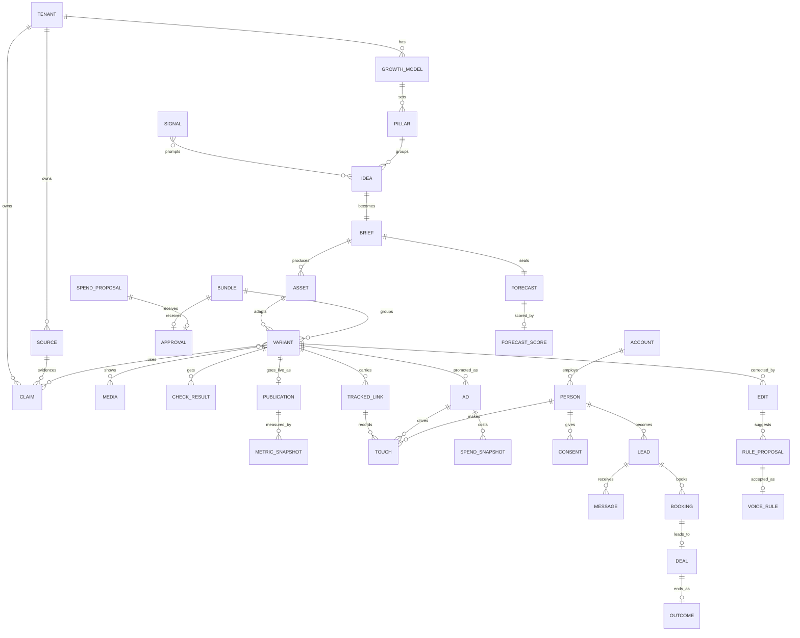
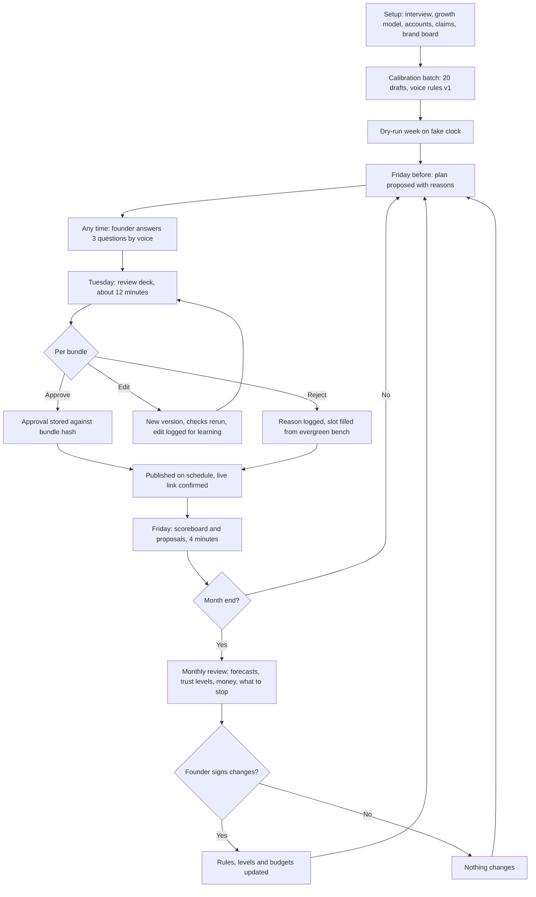
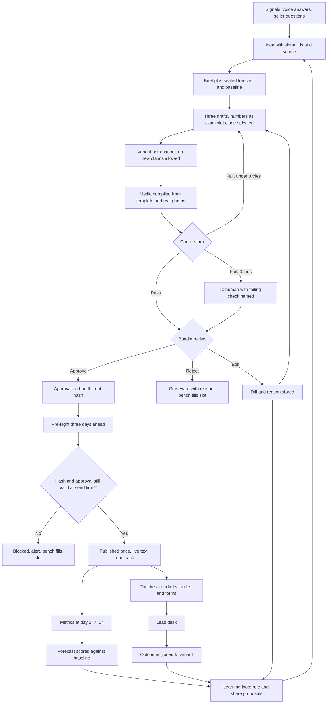
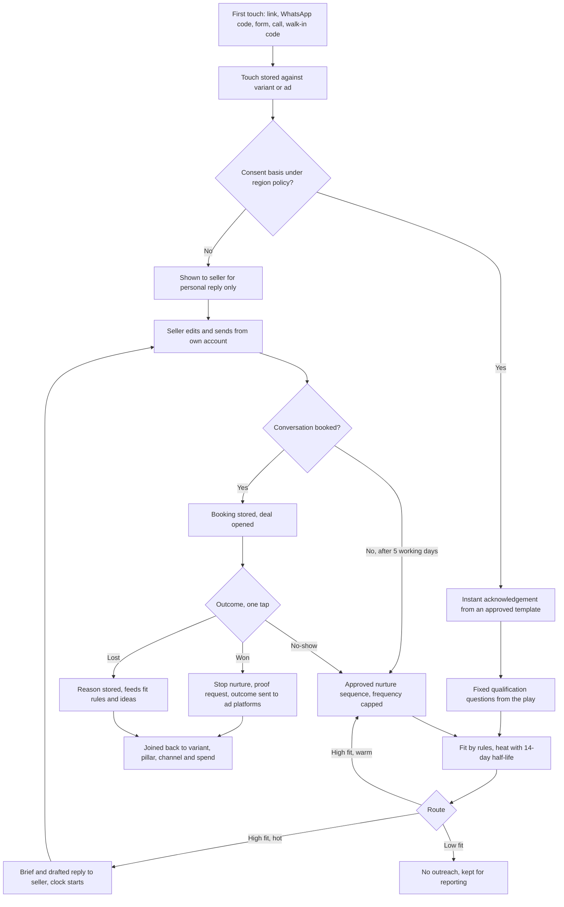

# Cortex Operator: a growth loop with receipts

Product plan, written 11 Nov 2026. Supersedes `~/cortex-operator/PLAN.md` (5 Nov) and the architecture brief (10 Nov) where they conflict.

Tags used throughout: `[V]` read from the vendor's own page today, `[E]` my estimate or arithmetic, `[T]` a target nobody has demonstrated yet, `[?]` I do not know.

---

## 0. Context

**Why this exists.** Two jobs. Get Sai hired as an AI growth operator by showing depth and judgment on a real business. Become something small companies pay for. It will be built by AI coding agents from this document.

**What prompted this version.** Three documents now describe three different products for three different customers:

| Document | Customer | Reviewer | Price | Reviewer time |
|---|---|---|---|---|
| `PLAN.md`, 5 Nov | Operators running 3 to 10 brands | The operator | EUR 500 to 800 per brand | Unstated |
| Architecture brief, 10 Nov | 20-person company with 5 marketers | One retained marketer | EUR 2,000 | 220 min a week |
| This prompt, 11 Nov | Small SaaS and service companies | The founder | Running cost under EUR 100 | Under 30 min a week |

These cannot all be true. This plan picks one and says why.

**Scope decision (Sai, 11 Nov).** Build all of it: every idea in Part 1, then the add-ons last. Every outside capability is an optional, swappable connection (section 2.1b). The revisions from Part 5 are folded into the body. This document is written to be handed to an orchestrating agent, so Part 4 is a set of self-contained work packages.

**Starting point.** The engine in `~/cortex-operator` is 1,060 lines and runs on mocks. Section 4.2 says what to keep.

**Intended outcome.** One committed design, a full build split into work packages an orchestrator can assign, and a public page of real numbers from a real business.

---

## 0.1 Where the brief, the research and the current positioning are wrong

### The positioning

1. **Kill the "5 marketers to 1" pitch.** The people who hire AI growth operators are marketing leaders. A portfolio piece whose headline is "I replace your team" loses that room. It also describes a buyer I doubt exists in numbers: a 20-person company with five marketers `[?]`. Most owner-led small companies have zero or one.
2. **Sell an operated service, not software.** A founder with 30 minutes a week will not configure claim libraries and design templates. Someone must. That someone is you at first, which is fine: it is the job you want, done in public. Software follows when the workflow stops changing. `PLAN.md` already said this. The brief drifted away from it.
3. **Stop calling it a content system.** Customer zero proves the point. A three-wheeler dealership with walk-in, finance-driven sales is not constrained by LinkedIn carousels. Its constraint is enquiry response, follow-up and finance approval. A reseller of simulation software is constrained by being found during research and by trial follow-up. A system that starts from "fill the calendar" produces the same thing for both. The product must start from the bottleneck and pick the play.

**New one-line position.** For buyers: "Your marketing, run for you. You approve in 30 minutes a week, and every post, lead and euro has a receipt." For hiring managers: "I build and run growth systems that can prove what they did, including the misses."

### The targets

| Target as written | Problem | What this plan does |
|---|---|---|
| Reviewer under 30 min a week | A human must approve every item and must actually look. Fifteen posts read line by line already breaks it. The brief's own routine was 220 min. | Budget the 30 minutes in seconds (section 2.5). Cut volume. Approve bundles. Measure the reviewer's attention. Exclude selling time and say so. |
| Approved without edits rising monthly | Perverse alone. Bland content and a tired reviewer both push it up. | Pair it with outcome per piece and with the reviewer catch rate. Reserve 20% of slots for experiments. |
| Factual errors under 1% at approval | Cannot be shown at this volume by counting posts. Zero errors in 300 units is needed for a 95% bound of 1% `[E: rule of three]`. | Count checkable sentences, not posts. Make numbers impossible for the model to type. Audit 20 sentences by hand weekly. |
| ROAS as high as possible | Wrong objective. The highest ROAS is the first euro on brand search. Maximising it shrinks the business. For lead generation the platform cannot see revenue at all. | Target cost per booked conversation against an allowable figure derived from margin. Feed qualified and won events back to the ad platforms. |
| Cost per lead falling monthly | Falls fastest when lead quality falls. | Track cost per qualified lead, per booked conversation and per won deal, on a 3-month rolling window with intervals. |
| Every channel | Each channel is an API approval, a format set and a failure surface. | Two or three channels per business, chosen by the play. More only when one is saturated. |

### The research documents

- **Agent swarms (both Gemini-style blueprints).** The brief already rejected LangGraph plus CrewAI plus Mem0 plus four guardrail products. I agree and go further: no agent framework at all. Code decides what happens next. Models are typed functions.
- **"Constants to hardcode" in the research pack.** Most are vendor blog numbers (ObserviX, Writer, Zen Media citing others). None go into the product or any pitch. The 61% and 94% buyer figures describe enterprise buying groups and say nothing about a dealership.
- **Bandits, auto-rollback, 5-minute SDR routing, USD 500 a day unreviewed spend.** All rejected by the brief. Correct.
- **Research pack sections 8.2 and 8.6 (automation bias, illusion of control).** The most useful pages in the pack and the least acted on. Nothing in any prior plan measures whether the reviewer is paying attention. This plan does.

### The architecture brief

Good on the ledger, the fail-closed publisher and the honest binomial bounds. Thin or wrong on:

- **No design system.** One line about templates, while "rejected for bad design" is a headline target and you are a designer.
- **Notion as the approval surface.** A Notion status can be flipped by any member or integration, and it cannot bind to a hash. A dealership owner will never open it. Notion stays as a calendar mirror.
- **Standing rules that publish unseen copy.** That contradicts "approval tied to the exact content". My resolution in section 2.8: new copy always gets a human yes. Autonomy is earned on everything around the yes, and the yes is made cheap.
- **A weekly 30-minute interview as the only source.** It alone consumes the whole reviewer budget, and one missed week starves the calendar.
- **HubSpot as the lead surface.** Irrelevant to a business that sells over WhatsApp and a register book.
- **Ads as an add-on.** Two of the eight targets are about ad money.
- **English-only checks.** One pilot business works in Tamil, the other in Italian.

### The existing code (read today)

| File | Issue | Fix |
|---|---|---|
| `cortex_operator/truth.py` | `SENTENCE` splits on every period, so "3.5 tonnes [[C-0001]]." likely becomes two fragments and the first is flagged unsupported. Confirm with a test. | Sentence segmentation that respects decimals and abbreviations. |
| `cortex_operator/truth.py` | `CHECKABLE` lists English superlatives only. | Digits stay universal. Superlative and comparative detection moves to a per-language list plus a model classifier. |
| `cortex_operator/gate.py` | `content_hash` hashes `item.media` as strings. A different image at the same path keeps the approval valid. | Hash file bytes. Store media as content-addressed objects. |
| `cortex_operator/contracts.py` | `Passport` has no expiry, no method, no bundle. | Add `expires_at`, `method`, `bundle_root`. |
| `cortex_operator/taste.py` | Rules are only `Avoid "phrase"` after two removals. Common words will be proposed. No scope, no test. | Section 2.7: typed rules with scope, provenance and a regression case. |
| `cortex_operator/foresight.py` | Point forecasts scored by absolute error. | Interval forecasts, scored against a naive baseline with an interval score. |
| `cortex_operator/store.py` | SQLite. | Postgres with row-level security per tenant. |

### The four inspiration repos

| Repo | What it really is | Take | Improve |
|---|---|---|---|
| EveryInc/Marketing-OS | Markdown skills for strategy, GTM, copy, art direction. No publishing, analytics, approval flow or declared licence. | The learning protocol: a correction stays local to a project until it transfers to fresh work. | Our rules carry a scope and must pass a transfer test before they go brand-wide. Copy nothing, since no licence is declared. |
| Yuzzyuk/marketing-os | One Claude skill, 14 markdown modules, MIT. Slop-pattern catalogue, 15 to 20 variants scored by a panel, a "what I couldn't determine" section. | The slop catalogue, generate-many-then-select, and the honesty section. | It is advice with no enforcement. Ours is enforced in code, and our graders are calibrated against this reviewer's real decisions. |
| efekangokcen/dou-social-crm | A showcase snapshot of an agency CRM. By its own README it does not run. | Encrypted credential vault, role list, activity log. | Its gap is our product: no content approval, no publishing, no measurement. |
| LinkedIn OS gist | A playbook built on third-party figures. | Hook length before "see more", hashtag and mention limits, carousel length, first-hour replies, never automate DMs or connection requests. | Stored as tunable channel rules marked unverified, then tested by our own sealed forecasts. |

---

## 0.2 Assumptions

1. The consented pilot business in the handoff is one of Vijay TVS or e-FEM. Section 4 works with either first.
2. "Booked meeting" means any booked sales conversation: a demo, a showroom visit, a test drive, a callback slot.
3. The 30-minute target covers reviewing and deciding. It excludes talking to leads and replying to comments, which are selling and relationship work.
4. You operate the system for the first clients. The founder reviews. Later a client-side marketer or an agency operator can take your seat.
5. Ad budgets are small, somewhere from EUR 200 to 2,000 a month `[?]`. The statistics are designed for that.
6. Law per region is out of scope. The system holds a policy table that a lawyer's answers fill.
7. 1 USD is treated as about 0.90 EUR `[E, not verified]`.
8. Neither pilot business has clean historical data on leads, close rates or margins `[?]`. Month one measures a baseline.
9. You have about 10 to 15 build hours a week until the internship ends in January 2027 `[E]`.
10. Model quality for Tamil copy and Tamil transcription is unknown to me `[?]`. Section 5 treats it as a risk.

## 0.3 The five hardest problems

| # | Problem | Why it is hard | Where it is solved |
|---|---|---|---|
| 1 | **The 30-minute paradox.** Every item approved by a person, in under 30 minutes a week, by a person who is really reading. | Speed and vigilance pull in opposite directions. A fast gate becomes a rubber stamp. | 2.5 time budget, 2.8 bundle approval and reviewer canaries |
| 2 | **Proving quality on tiny samples.** Under 1% factual errors and under 10% rejection, with 40 publications a month, checked by models that share the writer's blind spots. | Small n, correlated graders, no ground truth. | 2.7 claims as variables, cross-family second reader, weekly hand audit, grader calibration |
| 3 | **Design that does not look generated.** Across sizes, formats, three languages and two scripts, for businesses with weak brand assets. | Image models cannot set type or hold a grid. Taste is hard to specify. | 2.7 design compiled from tokens and templates, lint, real photos requested from the business |
| 4 | **Closing the loop to money at low volume.** Sales happen on WhatsApp, by phone and at a counter. Attribution is broken, conversions are few. | Decisions on noise are worse than no decisions. | 2.6 first-party codes, offline outcomes, shrinkage, a written stopping rule |
| 5 | **One product for opposite businesses, built by one person.** A vernacular walk-in dealership and a B2B software reseller. | Generic systems produce generic work. Every channel is an API approval. | 2.1 play library, 2.1b connections with a manual path for everything, 4 work packages in waves |

---

# PART 1. Brainstorm

No evaluation in this list. Thirty-two different ways to build or extend this, from safe to radical.

**Safe**

1. Hash-bound calendar spine: plan, draft, check, approve, publish.
2. Weekly recorded interview turned into every asset for the week.
3. Inbound response desk: each enquiry gets a brief and a drafted reply.
4. Search and answer-engine gap pages from Search Console queries.
5. Google Business Profile engine for local firms: posts, photos, question and review reply drafts.
6. Review and referral loop after each sale, with consent.
7. Fortnightly newsletter assembled from the best performers.

**Moderate**

8. Constraint-first diagnosis: a funnel model per business finds the bottleneck and chooses the play.
9. Voice-note newsroom: three questions sent to the owner's phone, answered by voice in their own language.
10. Raw-material requests: a weekly shot list to staff for real photos and clips, with consent capture.
11. Claims as typed variables: the model writes a slot, code fills the number.
12. Brand design system as code: tokens and templates render every size. No generated layouts.
13. Bundle approval: one yes covers a master and all its channel variants under one root hash.
14. WhatsApp-first lead desk with reference codes and pre-approved qualification flows.
15. Offline conversion feedback: qualified, booked and won events sent back to ad platforms.
16. Sales-question mining: questions and loss reasons logged by sellers become ideas and claim candidates.
17. Customer-proof engine: consented quotes and case stories after each win.
18. Founder profile desk for personal LinkedIn.
19. Play library: packaged motions per business type with channels, templates, questions and metrics.

**Unconventional**

20. Sealed forecasts on every piece, scored against a naive baseline, misses published.
21. Reviewer canaries: planted flawed items measure whether the human gate is awake.
22. Taste compiler: edits become proposed rules, each shipped with its own regression test.
23. Graveyard and subtraction memo: a monthly evidence-backed "stop doing this".
24. Sameness detector: flags when output recycles itself or matches a generic-AI corpus.
25. Counterfactual Quarter: paste a URL, get a dated plan built only from public evidence.
26. Brand memory as an open, client-owned folder under version control.
27. Public receipts page per client: what was published, approved, corrected and spent.

**Radical**

28. Outcome pricing wired to the ledger: pay per approved piece or per qualified booking.
29. Industry claim packs: manufacturer-approved specs shared across dealers of the same brand.
30. Synthetic buyer panel that pre-tests hooks, trusted only while it beats the baseline in sealed forecasts.
31. Customer voice surveys: post-purchase voice questions that harvest the buyer's own words.
32. Pin-code holdouts for local ads to measure true lift.

### Ranking

Ranked by impact on the eight targets per week of build, for one builder and two pilot businesses.

| Rank | Idea | Why |
|---|---|---|
| 1 | 1. Hash-bound spine | Already 80% built. Everything else hangs on it. |
| 2 | 8. Constraint-first diagnosis | Stops the system doing the wrong work well. A day of thinking, no code at first. |
| 3 | 11. Claims as variables | The only structural route to under 1% factual errors. |
| 4 | 12. Design system as code | The only structural route to under 10% design rejection. Plays to your strength. |
| 5 | 13. Bundle approval | Makes 30 minutes possible without bending the approval rule. |
| 6 | 14. WhatsApp-first lead desk | Where the money is for local firms. Fastest visible business value. |
| 7 | 9. Voice-note newsroom | Real source material for six minutes of owner time. |
| 8 | 21. Reviewer canaries | Nobody else measures the human. Turns the gate from theatre into evidence. |
| 9 | 15. Offline conversion feedback | The single biggest lever on ad efficiency for lead generation. |
| 10 | 22. Taste compiler with tests | Drives "approved without edits" up without drifting. |
| 11 | 20. Sealed forecasts | Built already. The honesty story for hiring managers. |
| 12 | 10. Raw-material requests | Real photos beat generated ones, and solve the fake-persona risk. |
| 13 | 19. Play library | Makes two opposite pilots one product. |
| 14 | 27. Public receipts page | The hiring artifact and the sales page in one. |
| 15 | 3. Inbound response desk | Folded into the lead desk for B2B. |
| 16 | 5. Business Profile engine | High value for local, needs API access approval `[?]`. |
| 17 | 4. Search gap pages | Compounds, slow to show. |
| 18 | 16. Sales-question mining | Nearly free once the lead desk exists. |
| 19 | 24. Sameness detector | Cheap guard against bland convergence. |
| 20 | 23. Subtraction memo | Cheap once measurement exists. |
| 21 | 17. Customer-proof engine | Strong, limited by how many customers agree. |
| 22 | 6. Review and referral loop | Same mechanism as 17 for local firms. |
| 23 | 18. Founder profile desk | Depends on the founder's appetite. |
| 24 | 7. Newsletter | Slow list growth at this size. |
| 25 | 26. Open brand memory | Trust wedge for operators later. |
| 26 | 2. Weekly interview | Replaced by 9 for the default. Kept as an option. |
| 27 | 32. Pin-code holdouts | Right method, needs more spend than pilots have. |
| 28 | 31. Customer voice surveys | Good language source, consent work first. |
| 29 | 29. Industry claim packs | Strong for dealers, needs a manufacturer relationship. |
| 30 | 28. Outcome pricing | Only after a baseline exists. |
| 31 | 25. Counterfactual Quarter | A demo more than a product. Built late, behind the precision gate `PLAN.md` asked for. |
| 32 | 30. Synthetic buyer panel | Unproven. Allowed only as a forecast input that must earn its place. |

**All 32 are in scope.** The rank sets build order, not inclusion. Section 2.2b gives every idea a module and Part 4 gives it a work package.

**What makes it ten times better than a scheduler with captions.** Five properties, each from the top of that list:

1. It chooses the work from the bottleneck, so a dealership and a software reseller get different systems.
2. It cannot state a fact it cannot source. Numbers are filled by code from a verified table.
3. Design is compiled from a brand system, never generated as a picture of a layout.
4. Every yes is bound to exact bytes, and the human giving it is measured too.
5. The loop closes on booked and won, including offline sales, and money moves only by a written rule a person signs.

---

# PART 2. The plan

## 2.1 The design in one page

```mermaid
flowchart LR
    D["Diagnose: growth model finds the bottleneck"] --> P["Plan: play, pillars, week plan, sealed forecast"]
    P --> S["Source: voice notes, photos, claims"]
    S --> M["Make: copy and media compiled from brand system"]
    M --> C["Check: code checks, graders, second reader"]
    C --> A["Approve: one yes per bundle, bound to hash"]
    A --> U["Publish: fail-closed, read back live"]
    U --> L["Capture: tracked links, WhatsApp codes, forms"]
    L --> Q["Lead desk: consent, fit, heat, drafted reply"]
    Q --> B["Booked, held, won or lost"]
    B --> R["Measure: outcomes joined to asset and spend"]
    R --> X["Learn: forecasts scored, rules proposed, budget proposed"]
    X --> D
```



**Default stack.** You said not to be bound by the suggested tools, so these are the defaults I would ship. Section 2.1b makes every outside tool in this table a replaceable connection.

| Layer | Choice | Reason | Rejected |
|---|---|---|---|
| Record of truth | One Postgres (Supabase), row-level security per tenant | Auth, storage and policies in one place. You already run Supabase for Casa. | SQLite, Notion databases, HubSpot as system of record |
| Orchestration | A fixed state machine in Python, jobs in a Postgres queue with `SKIP LOCKED`, one worker | Code decides next steps. Restart-safe. Testable with a fake clock, which the repo already does. | LangGraph, CrewAI, n8n in the core path |
| Models | Sonnet 5.5 drafts and briefs. Haiku 5.5 extracts, classifies and grades. Opus 5.5 writes the weekly plan and monthly memo. A Gemini Flash-Lite model is the second reader. | The checker comes from a different model family than the writer, so they share fewer blind spots. | One model for everything. Fine-tuning. |
| Design and media | Brand tokens plus HTML and CSS templates rendered by headless Chromium to PNG, PDF and video frames. `ffmpeg` for cuts and captions. Image model only for backgrounds and illustration slots. | Type, grid and colour are deterministic. Indic and Latin scripts render with real fonts. | Generated layouts as the default. Avatar or lip-sync of a real person without a consent record. |
| Review surface | A phone-first web app (Next.js PWA). Reviewer gets a link by email or WhatsApp. | The reviewer is a founder on a phone. Approval must bind to a hash. | Notion as approval surface, chat UI |
| Calendar view | Notion mirror, one way out plus comments in | Keeps the calendar you asked for without trusting it. | Notion as source of truth |
| Publishing | Postiz hosted for social. Direct adapters only where Postiz has no route. A manual "copy pack and confirm link" path for everything. | One integration covers most channels. The manual path means a refused API never blocks a client. | Self-hosted Postiz for now (needs own developer apps per platform) |
| Leads | Own lead tables and a lead desk screen. WhatsApp Cloud API and email as channels. Optional one-way sync to a client CRM. | Small firms have no CRM or do not use it. | HubSpot free as the required surface |
| Booking | Cal.com link, or a callback slot picker for walk-in businesses | Free tier exists `[V]`. | Building a scheduler |
| Analytics in | GA4, Search Console, Postiz analytics, Meta and Google Ads reporting, plus our own redirect and code logs | Our own logs make the asset-to-lead join independent of cookies. | Any single attribution number |

**The play library.** A play is a row set, not code: channels, formats, qualification questions, what counts as a booked conversation, default pillar mix, and the metrics that matter. Three ship.

| Play | Fits | Channels | Booked conversation | First bottleneck to test |
|---|---|---|---|---|
| A. Local, high-ticket, walk-in | Vijay TVS, any dealer or showroom | Google Business Profile, WhatsApp, Facebook and Instagram in the local language, local search ads, click-to-WhatsApp ads | Showroom visit, test drive or callback | Enquiry response time and follow-up completion, then finance readiness of leads |
| B. B2B technical, trial-led | e-FEM, small SaaS | Search and answer-engine pages, expert LinkedIn profile plus company page, email, search ads on category terms | Demo or trial kickoff call | Being found for evaluation queries, then trial follow-up |
| C. Appointment service | Studios, clinics, consultancies | Business Profile, Instagram, reviews, booking link | Appointment | Review volume and booking friction |

Play C is designed for, not piloted.

## 2.1b Connections: every outside capability is a swappable port

The rule: the core never calls a vendor. It calls a **capability**. Each client picks which **connection** serves that capability, and can change it at any time, per brand, per format, or for one single piece.

**Three modes, always in this order of availability.**

1. **Manual.** A person uploads the file, pastes the link, or types the number. Every capability has this mode, so the product works with zero connections and no refused API can block a client.
2. **Local.** Runs on your own machine or server: a template render, a local model, a self-hosted tool.
3. **Hosted.** A paid provider, with a model picker where the provider offers several.

**What never changes when a connection changes.** The gate, content hashing, claim checks, provenance, disclosure labels, cost ledger and regional policy all sit above the port. Swapping Postiz for a direct API, or one video model for another, cannot route around an approval.

| Capability | Manual | Local | Hosted, examples | Default |
|---|---|---|---|---|
| Text: plan, draft, grade, second read | Paste your own copy | Any local model behind an OpenAI-compatible endpoint (Ollama and similar) | Claude, Gemini, OpenAI, any OpenAI-compatible provider. Model chosen per role. | Claude tiers, Gemini as second reader |
| Image | Upload a photo or finished graphic | Template render. A local diffusion endpoint. | Gemini image models, models listed on Muapi, others | Real photos, template render, hosted model for backgrounds |
| Video | Upload a finished clip | Template render to video (HyperFrames or Remotion `[?: licence]`), `ffmpeg` cuts and captions, raea on a local GPU | Any generative video model reachable through a provider such as Muapi or Gemini `[?: prices]` | Local cuts of real clips |
| Transcription | Type the answer | Local Whisper-class model | Hosted transcription | Local |
| Voiceover | Record your own | Local speech model | Hosted speech model | Record your own |
| Publishing | Copy pack, then confirm the live link | Self-hosted Postiz | Postiz hosted, direct platform APIs, another scheduler | Postiz hosted |
| Calendar view | Built-in week plan | None | Notion, Google Calendar | Built-in, mirrored to Notion |
| Leads and CRM | Built-in lead desk, CSV in and out | None | HubSpot, Zoho, a Google Sheet | Built-in |
| Messaging | Click-to-chat links, the seller's own mailbox | Your own SMTP server | WhatsApp Cloud API, Brevo, Resend, SES | Manual for first replies, always |
| Booking | Callback slot list | None | Cal.com, Calendly | Cal.com |
| Analytics in | CSV upload or typed numbers | Our own redirect and code logs | GA4, Search Console, scheduler analytics, Plausible | Own logs plus GA4 and Search Console |
| Ads | Person makes the change, spend imported by CSV | None | Meta, Google Ads, LinkedIn Ads | Manual |
| Research | Paste notes | None | A web search provider | Off |
| Storage | None | Local disk | Supabase storage, any S3-compatible store | Supabase |
| Notifications | None | None | Email, WhatsApp, Telegram, web push | Email and push |
| Automation hooks | None | None | Outbound webhooks to n8n, Zapier or Make. Events out only. They cannot publish. | Off |

**The connection contract.** Every provider, including manual ones, implements the same five calls:

- `describe()`: what it can do, limits, models offered, unit cost, licence note.
- `health()`: connected, token expiry, quota left.
- `estimate(request)`: cost and time before anything runs.
- `run(request)`: returns the result with provenance (who or what made it, which model, which settings), cost and external ids.
- `mock()`: a deterministic fake for tests and the demo client.

**Selection.** Each client has a default connection per capability and an ordered fallback list. A brief, a template or a single review card can override it: "use my upload", "render locally", "regenerate with model X". The choice and its cost are stored on the media or variant row.

**Rules for generated media, whatever the connection.**

- Provenance is recorded per file: client photo, client clip, template render, or generated with model and prompt.
- Generated people, products and premises are off by default. A client can switch them on per format.
- A real, identifiable person is never generated, voiced or lip-synced without a consent record on file.
- Generated or materially altered media carries the disclosure label the regional policy row requires.
- A generated image never carries a factual claim about the product. Claims ride on real photos or typeset text.

**Adding a provider** is one file that implements the contract plus a row in the registry. No core code changes.

## 2.2 Modules

Effort is builder-days for one person directing AI coding agents `[E]`. Cost is per client per month. Targets: **T1** reviewer time, **T2** design or generic rejection, **T3** approved without edits, **T4** factual errors, **T5** on time, **T6** ad return, **T7** cost per lead and booking, **T8** running cost.

| # | Module | Job in plain language | Inputs | Outputs | Tools | Failure modes, and the guard | Cost | Effort | Moves |
|---|---|---|---|---|---|---|---|---|---|
| 1 | Tenant, policy and vault | Keeps each client's settings, people, regional rules and credentials apart | Client details, approver list, lawyer's answers per region, account tokens | `tenant`, `region_policy`, `channel_account`, encrypted secrets | Supabase RLS, AES-GCM vault | Cross-client leak. Expired token found on publish day. Guard: every query scoped by tenant in the database, token expiry checked daily with a 7-day warning | Share of hosting | 3 | T5 |
| 2 | Growth model | States how this business gets customers, with numbers, and names the bottleneck | Owner answers on prices, margin, close rate, where enquiries come from. Later, measured rates | `growth_model` stages with rates and ranges, chosen `play`, allowable cost per booked conversation | A form, SQL, one Opus memo | Owner guesses presented as facts. Guard: every rate is tagged guessed or measured, and guessed rates are replaced once 30 outcomes exist | Under EUR 1 | 2 | T6 T7 |
| 3 | Truth library | Holds every fact the business may state, with proof and an expiry | Site pages, brochures, price lists, transcripts, owner confirmation | `claim` rows: typed value, unit, source span, verified by, expires at | Haiku extraction, human verify screen | A wrong claim poisons everything downstream. A stale price. Guard: only a named person can verify. Prices and offers expire in 30 days by default. Any change voids approvals that used it | Under EUR 1 | 4 | T4 T3 |
| 4 | Brand system | Encodes how the brand sounds and looks so output starts close | 20 past posts, liked and disliked references, logo, fonts, colours, photos | `voice_rule`, `slop_pattern`, `design_token`, `template`, reference board | Tokens as JSON, HTML and CSS templates | Templates look the same every week. Rules contradict. Guard: at least 8 templates per format family with rotation, rule conflicts flagged at proposal time | Under EUR 1 | 8 | T2 T3 |
| 5 | Source capture | Gets real material out of the business with almost no effort | Three weekly questions answered by voice, photos and clips from staff, seller-logged questions | `source` rows with transcript, language, consent, media with content hash | Voice upload in the PWA or WhatsApp, transcription, `ffmpeg` | No answers this week. Transcript errors in names and numbers. Guard: a backlog of unused answers, and numbers from a transcript become claim candidates that still need verifying | EUR 1 to 3 | 4 | T1 T2 T4 |
| 6 | Signal intake | Pulls what happened on every connected channel each night | GA4, Search Console, Postiz analytics, ad platform reports, our redirect log | `signal`, `metric_snapshot`, `spend_snapshot`, raw pulls kept | Official APIs, nightly job | An API changes or a metric vanishes. Guard: per-adapter schema check, missing data shown as missing, never as zero | EUR 0 | 5 | T6 T7 |
| 7 | Planner | Proposes next week's pieces with a reason, a brief and a sealed prediction | Growth model, pillars, signals, source backlog, forecast scores, graveyard | `idea`, `brief`, `forecast`, week plan, Notion mirror | Opus weekly plan, Sonnet briefs, existing `foresight.py` | A calendar of guesses. Top-of-funnel only. Guard: no source, no slot. Stage mix checked against the play. Refuses to plan if claims or pillars are empty | EUR 2 to 4 | 5 | T1 T3 T7 |
| 8 | Copy production | Writes each piece from the brief, the source and the claims, per channel | Brief, source spans, allowed claims, voice rules, channel rules | `asset` master and `variant` rows with claim slots | Sonnet, three candidates then select | Generic tone. Invented detail. Guard: may quote only supplied sources, numbers appear only as claim slots, slop catalogue applied before selection | EUR 3 to 8 | 4 | T2 T3 T4 |
| 9 | Media production | Builds images, carousels and short clips from templates and real photos | Variant text, template, tokens, photo library, clips | `media` files with byte hashes and provenance | Image, video and voiceover connections (2.1b): upload, local render, or a chosen model | Text overflow, bad crop, wrong script font, an undisclosed generated person. Guard: design lint, generated people and products off by default and allowed only with consent and a disclosure label, provenance stored per file | EUR 1 to 4 | 8 | T2 T5 |
| 10 | Check stack | Catches problems before a person spends a second | Variants, media, claims, rules | `check_result` per check, pass or flag with the reason | Code checks, Haiku graders, cross-family second reader | Graders agree with the writer's mistakes. Guard: code checks first, second reader from another model family, graders lose their vote when they disagree with the reviewer too often | EUR 1 to 3 | 6 | T2 T4 T1 |
| 11 | Review deck and approval | A person approves exactly what will go out | Bundle of variants and media, claims used, check results, forecast | `approval` bound to the bundle root hash, with approver, method and expiry | PWA, existing `gate.py` extended | Edit after approval, stale facts, rubber-stamping. Guard: any byte or claim change voids the approval, approvals expire, canaries measure attention | Hosting | 6 | T1 T3 T4 |
| 12 | Publisher | Sends only approved bytes, on time, once, and proves it landed | Approved bundle, schedule, channel account | `publication` with external id, live URL, readback result | Postiz API, direct adapters, manual pack | Double post, silent failure, platform alters the text. Guard: idempotency key per variant, retry with backoff, live text read back and compared, evergreen bench fills a missed slot | USD 29 `[V]` | 4 | T5 |
| 13 | Engagement inbox | Brings comments and messages to a person with a suggested reply | Comments and messages from channels | Reply suggestions. A person sends. | Postiz or platform APIs `[?]`, Sonnet | An auto-reply to a complaint. Guard: no send path exists in code for this module | Under EUR 1 | 3 | T7 |
| 14 | Link and touch tracking | Ties every click, chat, call and walk-in back to the piece that caused it | Variant ids, short links, WhatsApp reference codes, QR and offer codes, "how did you hear" answers | `tracked_link`, `touch` | Our own redirector, form hidden fields | Codes stripped or forgotten. Guard: three independent signals (link, code, self-report) and the share of leads with no source reported weekly | Hosting | 3 | T6 T7 |
| 15 | Lead desk | Makes sure every enquiry gets a fast, correct first response and a next step | Touches, form fills, chats, consent, qualification answers | `person`, `account`, `lead` with fit and heat, drafted reply, task | Rule table, decay formula, Sonnet drafts, WhatsApp Cloud API, email | Contact without consent. A wrong promise. A lead forgotten. Guard: consent checked before any send, drafts only for the seller, a clock on every open lead | EUR 2 to 6 plus messages | 8 | T7 |
| 16 | Nurture and booking | Keeps warm leads moving with messages the owner approved once | Approved templates, lead stage, booking link | `message` instances, `booking` | Email provider, WhatsApp templates, Cal.com | Over-messaging. A template drifting from the truth. Guard: frequency caps per person, templates hash-approved, slots fill only from verified data | EUR 0 to 9 | 5 | T7 |
| 17 | Pipeline mirror | Records what happened after the booking | Seller taps: held, won with amount, lost with reason | `deal`, `outcome`, optional CRM sync | Lead desk buttons, sync job | Sellers do not log. Guard: one tap from a WhatsApp reminder, weekly unlogged count on the scoreboard | EUR 0 | 3 | T6 T7 |
| 18 | Ads desk | Prepares ads, proposes every budget change, and feeds real outcomes back to the platforms | Approved variants, allowable cost, spend and outcome data | Paused ads, `spend_proposal`, offline conversion uploads | Meta and Google Ads APIs `[?: access]`, or manual checklists | Money spent on unapproved creative. Chasing cheap bad leads. Guard: ads created paused, every change is a signed proposal, automatic action is limited to pausing | EUR 1 to 3 | 8 | T6 T7 |
| 19 | Measurement and decision engine | Says which pillars, formats and channels earn more, how sure it is, and what to change | Publications, touches, leads, outcomes, spend | Estimates with intervals, calendar share proposal, budget proposal, "no decision" | SQL, a small Bayesian shrinkage script | Declaring winners from noise. Guard: minimum evidence rule, capped moves, "no decision" is a valid output | Under EUR 1 | 6 | T6 T7 T3 |
| 20 | Learning loop | Turns each edit and rejection into a tested improvement | Draft versus final diffs, rejection reasons, forecast scores | `rule_proposal` with scope and a regression case, new `prompt_version` | Extended `taste.py`, eval harness | Rules pile up and flatten the voice. Guard: every rule needs its triggering edit, passes old cases, and expires if unused for 90 days | EUR 1 to 2 | 6 | T2 T3 |
| 21 | Trust ladder and audit | Tracks how much freedom each task type has earned, and takes it back on failure | Approvals, defects, canary results, incidents, model and prompt versions | `autonomy_state`, hash-chained `audit_log`, incidents, cost breakers | SQL, existing ledger pattern | Freedom granted on thin evidence. Runaway cost. Guard: unlock rules with stated bounds, same-day demotion, per-run and per-day cost caps | Under EUR 1 | 5 | T1 T4 T8 |
| 22 | Scoreboard and reports | Shows the eight numbers honestly, weekly and monthly | Everything above | Weekly scoreboard, monthly memo, public receipts page, export | SQL, Opus memo, static page | Vanity numbers. Guard: every figure shows its sample size and method, misses are listed first | EUR 1 | 4 | All |

Modules 1 to 22 are about 110 builder-days `[E]`. Modules 23 to 39 below add about 70 `[E]`. Part 4 splits all of it into work packages that run in parallel waves.

### 2.2b Modules that give every Part 1 idea a home

| # | Module | Job in plain language | Inputs | Outputs | Tools | Failure modes, and the guard | Cost | Effort | Moves |
|---|---|---|---|---|---|---|---|---|---|
| 23 | Connections registry | Lets each client choose how every outside capability is served, and swap it freely | Provider files, client choices, secrets | `connection`, `provider`, health status, per-run provenance and cost | The contract in 2.1b, vault | A provider quietly changes behaviour. A choice with no fallback. Guard: health check daily, manual mode always present, contract tests run against every provider | Hosting | 6 | T5 T8 |
| 24 | Eval harness and prompt registry | Proves a prompt or model change is better before it goes live | Regression cases from real edits, golden sets, forecast scores | `prompt_version`, eval runs, pass or fail per change | Test runner, graders | A change that helps one client and hurts another. Guard: per-client case sets, no deploy on a failed run | Under EUR 2 | 4 | T2 T3 T4 |
| 25 | Operator API and MCP server | Lets you or another agent drive the system from outside, safely | Authenticated calls | Every screen action as an API call and an MCP tool | FastAPI, MCP | An agent approves its own work. Guard: approval, claim verification and spend signing are refused to non-human callers | Hosting | 4 | T1 |
| 26 | Demo client | A seeded fictional business anyone can click through | Seed data, the fake clock, mock connections | A full replayable month, with no real client data | `mock()` on every provider | Demo data mistaken for results. Guard: every demo screen is labelled as a simulation | EUR 0 | 3 | Hiring |
| 27 | Business Profile engine | Keeps a local firm's Google listing fresh and answered | Photos, offers, questions, reviews | Posts, photo updates, drafted answers and review replies for a person to send | Business Profile API `[?: access]`, or manual pack | A reply to an angry review sent unread. Guard: no send path for replies | Under EUR 1 | 5 | T7 |
| 28 | Search and answer-engine pages | Writes the pages buyers and AI assistants look for | Queries with impressions and no page, claims | Answer-first pages with tables, schema markup, a "last verified" date | Search Console, site CMS connection or manual export | Thin pages at scale, which search engines punish. Guard: one page per real query cluster, each with a named human reviewer | EUR 2 to 5 | 5 | T7 |
| 29 | Proof, referral and customer voice | Turns happy customers into evidence and into the brand's own vocabulary | Won deals, consent, three recorded answers | Quote cards, case stories, review and referral asks, buyer-language notes | Voice capture, templates | Using a customer's words or face without consent. Guard: consent record required before any asset is drafted | EUR 1 to 3 | 5 | T2 T7 |
| 30 | Founder profile desk | Drafts posts for the founder's own profile from their voice answers | Voice answers, voice profile for the person | Personal-profile variants in the review deck | Copy production | Ghostwritten views the founder does not hold. Guard: only from their own recorded answers | Under EUR 1 | 2 | T7 |
| 31 | Newsletter | A fortnightly email built from pieces that beat forecast | Top pieces, consented list | An approved issue, replies routed to the lead desk | Email connection | Sending to people without consent. Guard: list filtered by the consent table at send time | EUR 0 to 9 | 3 | T7 |
| 32 | Brand memory export | Hands the client everything, in open files, at any time | All client rows and media | A versioned folder: voice, claims with evidence, templates, graveyard, results, audit log | Export job | A partial export. Guard: export is verified by re-import into an empty client | EUR 0 | 3 | Trust |
| 33 | Graveyard, sales questions and subtraction memo | Remembers what was killed and why, mines seller questions, and says what to stop | Rejections, loss reasons, seller-logged questions, outcomes | Idea candidates, claim candidates, a monthly "stop doing" memo with evidence | SQL, Opus memo | Stopping something on thin data. Guard: the minimum evidence rule from 2.6 | Under EUR 1 | 2 | T1 T7 |
| 34 | Counterfactual Quarter | Shows what the system would have planned for any company, from public evidence only | A URL, public pages dated before a cut-off | A labelled simulation: dated claims, a plan, one finished week | Research connection, the full pipeline on mocks | A false statement about a real company. Guard: precision check, neutral wording, private expiring links, a human check before anything is sent | EUR 1 to 3 per run | 8 | Hiring |
| 35 | Buyer panel | Pre-tests hooks and messages against simulated buyers | Brief, variants, buyer notes from module 29 | A ranking with reasons, used as one input to the forecast | Text connection | Trusting a simulation. Guard: the panel's picks are sealed and scored like any forecast, and it loses its vote if it does not beat the baseline | Under EUR 2 | 4 | T2 T3 |
| 36 | Industry claim packs | Shares manufacturer-approved facts across clients selling the same product | A manufacturer's spec sheets and approved wording | A claim pack a new client imports and verifies | Truth library | A stale spec spreading to many clients. Guard: pack claims expire together and each client still verifies on import | EUR 0 | 3 | T4 |
| 37 | Holdout experiments | Measures true lift by withholding ads from a region or a week | Spend, outcomes by region and week | A lift estimate with a range, or "not enough data" | SQL, ads connection | A test too small to read. Guard: refuses to start below a spend floor | EUR 0 | 4 | T6 |
| 38 | Outcome pricing ledger | Lets the service be billed per approved piece or per qualified booking | Approvals, publications, qualified bookings | A billable statement the client can audit | SQL, export | Disputes over what counts. Guard: definitions fixed in the client's policy rows, every line links to its record | EUR 0 | 3 | Commercial |
| 39 | Play library editor | Lets an operator create or tune a play without code | Channel, format, question and metric choices | `play` rows, including play C | Web form | A play that contradicts regional policy. Guard: validated against the policy table on save | EUR 0 | 3 | T7 |

### 2.2c Where each Part 1 idea lands

| Idea | Module | Wave |
|---|---|---|
| 1 Hash-bound spine | 7, 8, 10, 11, 12 | 1 to 2 |
| 2 Weekly interview | 5, as an optional capture mode | 3 |
| 3 Inbound response desk | 15 | 3 |
| 4 Search and answer-engine pages | 28 | 6 |
| 5 Business Profile engine | 27 | 6 |
| 6 Review and referral loop | 29 | 6 |
| 7 Newsletter | 31 | 6 |
| 8 Constraint-first diagnosis | 2 | 3 |
| 9 Voice-note newsroom | 5 | 3 |
| 10 Raw-material requests | 5 | 3 |
| 11 Claims as variables | 3 | 1 |
| 12 Design system as code | 4, 9 | 2 |
| 13 Bundle approval | 11 | 1 |
| 14 WhatsApp-first lead desk | 14, 15 | 3 |
| 15 Offline conversion feedback | 18 | 5 |
| 16 Sales-question mining | 33 | 6 |
| 17 Customer-proof engine | 29 | 6 |
| 18 Founder profile desk | 30 | 6 |
| 19 Play library | 2, 39 | 3 and 6 |
| 20 Sealed forecasts | 7, 19 | 4 |
| 21 Reviewer canaries | 21 | 4 |
| 22 Taste compiler with tests | 20, 24 | 4 |
| 23 Graveyard and subtraction memo | 33 | 6 |
| 24 Sameness detector | 10 | 2 |
| 25 Counterfactual Quarter | 34 | 6 |
| 26 Open brand memory | 32 | 6 |
| 27 Public receipts page | 22 | 4 |
| 28 Outcome pricing | 38 | 6 |
| 29 Industry claim packs | 36 | 6 |
| 30 Synthetic buyer panel | 35 | 6 |
| 31 Customer voice surveys | 29 | 6 |
| 32 Pin-code holdouts | 37 | 6 |

### How each target is moved

| Target | Mechanisms, in order of weight |
|---|---|
| T1 Reviewer under 30 min | Fewer pieces (5 primary a week). Bundle approval (11). Checks collapse clean items (10). Voice capture replaces the interview (5). Plan auto-accepts proven slots at L3 (21). |
| T2 Design or generic rejection under 10% | Compiled design and lint (4, 9). Slop catalogue and sameness check (8, 10). Real photos requested (5). Rejection reasons routed to the exact fix (20). |
| T3 Approved without edits rising | Taste compiler with regression tests (20). Voice rules with provenance (4). Briefs from real source (5, 7). Balanced by a 20% experiment quota so it cannot be gamed by blandness. |
| T4 Factual errors under 1% at approval | Claims as variables (3, 8). Source-only drafting (8). Cross-family second reader (10). Weekly 20-sentence hand audit (21). |
| T5 On time over 95% | Content ready three days early (7). Pre-flight per channel (12). Token expiry watch (1). Idempotent retries (12). Evergreen bench of approved pieces (12). Reviewer nudges at 48 and 24 hours. |
| T6 Ad return | Allowable cost from margin (2). Offline outcomes fed back (18). Paid distribution only for forecast-beating organic pieces (19). Stopping rule (18). |
| T7 Cost per lead and booking falling | Faster first response (15). No outreach to low-fit leads (15). Calendar share moves to what books conversations (19). Follow-up never forgotten (15, 16). |
| T8 Running cost under EUR 100 | Model tiering and caching (8, 10). Per-run caps (21). One shared worker. Deterministic code wherever a rule will do. |

## 2.3 Data model

Every row carries `tenant_id`. Rows that came from a model also carry `prompt_version` and `model_id`, so a quality change can be traced to its cause.



**The chain, in words.**

- `signal` and `source` prompt an `idea`. An accepted idea becomes a `brief` with one sealed `forecast`.
- A brief produces one `asset` (the master) and one `variant` per channel. Each variant lists the `claim` rows and `media` it uses.
- Variants of one asset form a `bundle`. The bundle root hash covers every variant's text, every media file's bytes, every claim's evidence hash, the rule version and the channel.
- An `approval` points at that root. A `publication` can only be created from a variant whose bundle has a live approval.
- Each publication carries a `tracked_link`, a WhatsApp reference code, or both. A click or a coded chat creates a `touch` on a `person`.
- A person with a touch and a consent basis becomes a `lead`. Leads get `message` rows, a `booking`, then a `deal` and an `outcome` with amount or loss reason.
- `metric_snapshot` at day 2, 7 and 14 scores the `forecast`. Outcomes join back through touch to variant, pillar, format and channel, and through `ad` to spend.
- Every reviewer `edit` is stored as a diff with a reason. Repeated edits create a `rule_proposal`.

**Fields worth fixing on day one.**

- `claim`: `kind` (number, price, date, name, quote, capability), `value`, `unit`, `as_of`, `source_id`, `source_span`, `verified_by`, `verified_at`, `expires_at`, `languages` (approved wording per language).
- `media`: `sha256`, `provenance` (client photo, client clip, template render, generated background), `consent_id` when a person is identifiable, `alt_text`.
- `approval`: `bundle_root`, `approver_id`, `method` (per_bundle, express_list, template_instance), `seconds_on_screen`, `expires_at`, `canary` flag.
- `touch`: `kind` (link, whatsapp_code, form, call, walk_in_code, self_report), `variant_id`, `ad_id`, `occurred_at`. No IP address stored.
- `lead`: `fit` 0 to 100 from a readable rule table, `heat` as a decayed sum with a 14-day half-life (decay constant 0.0495 per day, which the brief verified), never blended into one number.
- `spend_proposal`: `campaign`, `from_daily`, `to_daily`, `reason`, `evidence_window`, `rule_fired`, then an approval.
- `autonomy_state`: `task_type`, `level`, `window_items`, `defects`, `escaped`, `canaries_shown`, `canaries_caught`.

## 2.4 Screens

| Screen | Who | What it shows |
|---|---|---|
| **Review deck** | Founder, phone | One card per bundle. Rendered pieces, swipe across channels. One line on why this piece and why now. Claims used, each tappable to its source. Check results, collapsed when clean. Forecast range. Actions: approve, edit in place (checks rerun in seconds), reject with one tap on a reason, later. Any image or clip on a card can be replaced by an upload, rendered locally, or regenerated with a chosen model. |
| **Voice inbox** | Founder, staff | This week's three questions with a record button. Shot-list requests ("a 20-second clip of today's delivery"). Upload with a consent tick when a customer is visible. |
| **Week plan** | Founder, operator | Seven days of slots by channel. Each slot shows pillar, funnel stage and status. A bar comparing the stage mix with the play's target. Drag to move, tap to kill. Mirrored to Notion. |
| **Lead desk** | Seller | Leads on a fit-by-heat grid. Per lead: where they came from, their answers, the suggested next step, a drafted reply that opens in WhatsApp or mail, a clock, and outcome buttons (booked, no answer, not a fit, held, won, lost with reason). |
| **Money** | Founder | Spend by campaign. Cost per qualified lead and per booked conversation with ranges. Pacing against caps. A queue of spend proposals, each with the rule that fired, to sign or decline. |
| **Scoreboard** | Founder, public version | The eight targets with trend and sample size. Forecast hits and misses, biggest miss first. What earned calendar share. Leads with no known source. |
| **Truth library** | Operator, founder | Claims with value, source, expiry and where used. Expiring soon. Candidates awaiting verification. |
| **Brand system** | Operator | Voice rules, each linked to the edit that created it. Slop catalogue. Template gallery with pass rates. Board of approved and rejected examples. |
| **Trust and audit** | Operator, founder | Level per task type with evidence counts and bounds. Canary results. Incidents. Kill switch per brand and global. Full export. |
| **Operator console** | Sai | All clients: queue health, cost against cap, breaker trips, prompt versions, eval results, token expiries. |
| **Connections** | Operator, founder | One row per capability: text, image, video, transcription, publishing, calendar, CRM, messaging, booking, analytics, ads, storage. For each: the chosen mode (manual, local, hosted), the provider and model, health, quota, cost this month, a test button, and the fallback order. Add or swap a provider without touching anything else. |
| **Demo** | Anyone with the link | The seeded fictional business, replayable on the fake clock, every screen labelled as a simulation. |

## 2.5 Journey of the user

**Setup, once, over two weeks.** Founder minutes are the scarce resource, so the operator does the heavy work.

| Who | Step | Minutes |
|---|---|---|
| Founder | Kickoff interview, recorded: customers, offer, what must never be said | 45 |
| Founder | Growth model form: prices, margin, where enquiries come from, close rate guesses | 15 |
| Founder | Connect accounts with the operator on a call | 30 |
| Founder | Verify about 40 claim candidates the system extracted, 30 seconds each | 25 |
| Founder | Brand board: pick 10 liked and 10 disliked references | 15 |
| Founder | Calibration batch: react to 20 drafts | 40 |
| Founder | Sign the policy, approver list and spend caps | 10 |
| **Founder total** | | **180** `[E]` |
| Operator | Ingest site and documents, extract claim candidates | 60 |
| Operator | Design tokens and first 8 templates | 300 |
| Operator | Voice rules v1 from past posts and kickoff | 60 |
| Operator | Play selection, pillars, qualification questions, lead routing | 90 |
| Operator | Tracking: redirector, codes, forms, analytics connections | 120 |
| Operator | Region policy rows from the client's adviser | 30 |
| Operator | Dry-run week on a fake clock | 60 |
| **Operator total** | | **720** `[E]` |

**Weekly routine at steady state** `[T]`. Expect 60 to 90 minutes a week in month one `[E]`.

| When | Step | Minutes |
|---|---|---|
| Any time | Answer three questions by voice | 6 |
| Tuesday | Review deck: about 8 bundles at 75 seconds, plus two edits | 12 |
| Tuesday | Glance at next week's plan, kill or move | 2 |
| Friday | Scoreboard, sign or decline proposals | 4 |
| **Total** | | **24** |

**Monthly review**, 20 minutes, replacing nothing: forecast record (5), trust levels and rule proposals (5), money and budget proposal (5), next month's themes and what to stop (5). Averaged in, the founder spends about 29 minutes a week `[T]`.

**Not counted, and said plainly:** replying to leads, replying to comments, and a 90-minute strategy session each quarter.



## 2.6 Journey of a post, a lead, and the money

### Journey of a post

1. **Signal.** Nightly pulls plus this week's voice answers and seller questions arrive. Web research is stored as untrusted text and can only suggest a claim candidate.
2. **Idea.** The planner proposes ideas, each with its signal ids, pillar, funnel stage and source. No source, no idea.
3. **Brief and forecast.** The brief names the audience, the job the buyer is trying to do, the single message, the channel, the allowed claims and the call to action. A forecast range for one metric at day 14 is sealed alongside a naive baseline.
4. **Draft.** Three candidates for the master. Numbers exist only as claim slots. The slop catalogue and the sameness check run. One candidate is selected, with the reason stored.
5. **Adapt.** One variant per channel. Variants may shorten, reorder and reformat. They may not add a claim.
6. **Media.** Text flows into a template chosen from the rotation. Real photos first, generated backgrounds second. The connection for each image or clip follows the client's defaults and can be overridden on the card.
7. **Check.** Code checks, then graders, then the second reader. Up to three repair loops, then to the human with the failing check named.
8. **Bundle and approve.** Master and variants appear as one card. One yes creates an approval on the bundle root.
9. **Pre-flight and schedule.** Size, length, link, account connection and time zone are checked three days ahead.
10. **Publish.** The publisher recomputes the hash, checks the approval is live, sends once, and reads the live post back to compare.
11. **Capture.** Clicks, coded chats and forms create touches tied to the variant.
12. **Measure.** Metrics at day 2, 7 and 14. Leads and outcomes join back as they happen.
13. **Learn.** The forecast is scored. The edit diff and any rejection reason go to the learning loop. The pillar, format and channel estimates update.



### Journey of a lead

1. **First touch.** A tracked click, a WhatsApp chat carrying a reference code, a form, a call, or a walk-in who mentions an offer code. A `touch` is stored against the variant or ad.
2. **Identity.** The person is matched or created. Company comes from the email domain or the lead's own answer. No scraped profiles.
3. **Consent.** The region policy row decides what may be sent, on which channel, with which footer. No basis means the lead is shown to the seller for a personal reply only.
4. **Instant acknowledgement.** A message the owner approved once, by hash, with slots filled only from the lead's own words. It promises nothing.
5. **Qualification.** Two or three fixed questions from the play. For a dealer: which model, cash or finance, town, timing. For a software reseller: use case, current tool, team size, timing. Answers are stored as typed fields.
6. **Scoring.** Fit from the rule table. Heat from decayed actions. Two numbers, shown on a grid.
7. **Routing.** High fit and hot: an account brief and a drafted reply reach the seller with a clock. High fit and warm: an approved nurture sequence. Low fit: no outreach, kept for reporting.
8. **Human reply.** The seller edits and sends from their own WhatsApp or mailbox. This never becomes automatic.
9. **Booking.** The reply carries the booking link or a callback slot. A booking creates the deal.
10. **Outcome.** One tap from the seller: held or no-show, then won with amount or lost with a reason from a fixed list.
11. **After.** Won: nurture stops, a customer-proof request is scheduled, outcome events go to the ad platforms. Lost: the reason feeds the fit rules and the idea queue.



### How it decides what performs better

**One outcome ladder.** Each piece and channel is judged on the highest rung that has enough data:

1. Won deals and their value.
2. Booked conversations.
3. Qualified leads.
4. High-intent actions: chat starts, calls, direction requests, pricing or trial page visits.
5. Engaged reach from the target audience: saves, shares, real comments.

Reach and likes alone never move a decision.

**Three source signals, side by side.** First touch, last touch, and the lead's own answer to "how did you hear about us". None is called the truth. The scoreboard shows all three and the share of leads with no source at all.

**Shrinkage, so small numbers stay humble.** Each attribute (pillar, format, hook type, channel) gets a rate estimate pulled toward the brand's overall average, with the pull weakening as evidence grows. In plain terms: three bookings from four posts does not beat ten from forty until there is more data. The engine reports the probability that one attribute beats another.

**A minimum evidence rule.** No proposal unless that probability is at least 80% and each side has at least 8 pieces. Otherwise the output is "no decision this month", in those words.

**Capped moves.** A pillar's share of the calendar moves by at most 10 points a month. No pillar drops below 10%. Twenty percent of slots stay reserved for new ideas.

**Forecasts as the referee.** A prompt version, a hook type or a planner change gets credit only if its sealed forecasts beat the naive baseline. Otherwise it is noise that happened to look good.

**How it changes the plan.** The Friday proposal lists the share change, the evidence, and the pieces that would be dropped. The founder signs it or does not.

### How it moves the ad budget

**The target is derived, never guessed.**

- Allowable cost per booked conversation: `A = margin per won deal x show rate x close rate x share of margin the owner will spend`. The share defaults to 30% and the owner sets it.
- Break-even return on ad spend is `1 / margin rate`. The target return is `1 / (margin rate x share)`.
- Worked example with invented numbers, for illustration only: margin EUR 600 per deal, 70% of bookings held, 25% of held conversations won, 30% share. `A = 600 x 0.70 x 0.25 x 0.30 = EUR 31.50` per booked conversation.

**A stated target per channel**, as a multiple of `A`. These multiples are my starting defaults, not benchmarks `[E]`. They are retuned after 90 days of the client's own data.

| Channel role | Target cost per booked conversation | Reason |
|---|---|---|
| Search on brand and high-intent terms | At most 0.6 A | Demand already exists. It should be the cheapest. |
| Local social, click-to-WhatsApp or lead forms | At most 1.0 A | Creates demand. Judged on qualified rate, never on raw lead cost. |
| Boosting an organic piece | At most 1.0 A | Only pieces that beat their sealed forecast get paid reach. |
| Retargeting | At most 0.8 A, capped at 20% of budget | Many of these people would have come anyway. |
| LinkedIn to a named account list (B2B) | At most 1.5 A for 90 days, then 1.0 A | Expensive clicks. Justified only where deal value is high and repeat revenue exists. |

**The method to reach it, in order.**

1. **Feed real outcomes back.** Qualified, booked and won events are uploaded to Google and Meta so their bidding chases buyers instead of form fills. For lead generation this is the largest single lever I know of.
2. **Promote proven pieces.** Paid creative comes from organic pieces that beat forecast, so the test was free.
3. **Keep the message continuous.** The ad, the landing page or WhatsApp opener, and the first reply all carry the same claim.
4. **Prune weekly.** Search terms that never qualify become negative keywords, proposed for sign-off.
5. **A written stopping rule.** If a campaign has spent 3 x A with zero booked conversations, a pause is proposed. Reasoning: if the true cost were A, the chance of zero bookings after spending 3 A is about 5% `[E: Poisson, e to the minus 3]`.
6. **Capped shifts.** Budget moves toward the lowest cost per qualified booking, at most 20% of a campaign's budget per week, so platform learning is not reset `[?: exact platform thresholds not verified]`.
7. **Holdouts when spend allows.** Above roughly EUR 1,500 a month on one platform `[E]`, a region or a week is held out to measure true lift.

**Who moves the money.** Every increase, new campaign and new creative is a `spend_proposal` a named person signs. In the first months the person also makes the change in the ad platform and the system verifies it. Later the system applies signed changes itself. The only thing it may do unasked is pause: on a tripped cap, a broken landing page, or pacing above 150% of the daily cap. Pausing spends less, so it sits inside the hard rule.

## 2.7 Keeping rejection under 10%

Two different failures hide in that target. Bad design is a production problem. Generic copy is a source problem. They get different fixes.

### Design: compile it

- **Tokens.** Colours, type scale, spacing, radii, logo rules and photo treatment live as JSON per brand. Fonts are chosen per script, so Tamil, Italian and English all set properly.
- **Templates.** HTML and CSS, about 8 per format family: single image, carousel, quote, proof card, offer, short video frame. Text flows into slots with length limits. A rotation rule stops the same template appearing twice in five posts.
- **Render.** Headless Chromium produces every size from one master. Carousels export as PDF for LinkedIn and as image sets elsewhere.
- **Real material first.** The photo library is fed by weekly shot-list requests. By default a generated image is a background or an abstract illustration, and people, products and premises are real. A client can switch on generated imagery or video per format through its connections, under the rules in 2.1b.
- **Design lint, in code.** Contrast ratio, minimum font size per channel, text overflow, safe zones, logo clear space, words per slide, face and product crop. A failing render never reaches a person.
- **Reference grader.** A vision model compares each render with the brand's approved and rejected boards and names the nearest rejected example. It flags. It does not block.

### Copy: source it, then strip it

- **Source or silence.** A piece is drafted from the owner's voice answers, staff material and claims. A brief with no source produces no draft.
- **Voice profile.** Per brand and per channel: sentences that pass, sentences that fail, banned terms, formality band, and pairs of on-voice versus off-voice wording.
- **Slop catalogue.** Banned constructions per language: empty openers, false contrasts, triads, hype adjectives, the phrases reviewers have already removed.
- **Many, then one.** Three candidates. Graders score against the voice profile and the brief. The best is selected and the reason is stored.
- **Sameness check.** Each draft is compared with the brand's last 50 pieces and with a small corpus of generic AI marketing copy. Too close to either and it is redrafted.

### Facts: make errors impossible to type

- **Claims as variables.** The writer emits `{{C-0012}}`. Code fills the value and unit from the claim row in the right language. The model never types a number, a price or a customer name.
- **Compile step.** Any digit, superlative, comparison or named customer outside a slot fails the build.
- **Second reader from another model family.** Each remaining assertion is checked against the source spans it was allowed to use. Unsupported sentences are flagged with the span that should have backed them.
- **Weekly hand audit.** The operator verifies 20 checkable sentences against sources. This is the measurement behind T4. Three hundred clean sentences are needed to claim under 1% with 95% confidence `[E]`, which takes roughly 8 to 15 weeks at this volume `[E]`.

### Learning from every rejection

- **One-tap reasons.** Off voice, generic, wrong fact, weak visual, wrong timing, not interesting, other. Each routes to one place: voice rules, slop catalogue, truth library, templates, calendar, idea scoring.
- **Edits become typed rules.** A diff between draft and final is classified: word swap, cut, tone shift, structure change, fact fix. Two similar edits create a `rule_proposal` with a scope (this pillar, this channel, or the whole brand).
- **Each rule ships with its test.** The triggering draft and the human's final version become a regression case. A new prompt version must still pass every old case before it goes live.
- **Transfer before promotion.** A rule stays scoped to its pillar until it has improved fresh work elsewhere. Rules unused for 90 days expire.
- **Graders are graded.** Each week grader verdicts are compared with what the reviewer did. A grader that agrees less than 80% of the time over 30 items loses its vote until recalibrated.

## 2.8 Where a human always stays, and the trust ladder

### Permanent human decisions

| Stays human | Why |
|---|---|
| The yes on any new copy or creative | The hard rule. Also the only real check on taste. |
| Verifying a claim | Every downstream check trusts this table. If a model can write to it, nothing is proven. |
| First reply to a named person, and all negotiation | Cannot be recalled. A wrong promise on price, finance or delivery is a liability. |
| Replies to comments, complaints and reviews | Platform rules and plain decency. Suggestions are fine. |
| Any spend increase, new campaign or new audience | Money moved in error does not come back. |
| Statements about named customers, competitors, pricing, legal or safety matters | Highest liability per sentence. The facts live in contracts and heads. |
| Raising a trust level or signing a template | Accountability needs a name. |
| Strategy: who to serve, what to stand for, what to refuse | The system has no stake and no customers. |
| Consent calls and anything the region policy marks as legal | Out of scope for software. |

### The ladder

Autonomy is tracked per client and per task type, for example "LinkedIn text post" or "offer carousel". A defect is a rejection or an edit that changes meaning, a claim or anything a hard rule covers. Typo fixes are logged and do not count.

| Level | What the system does alone | What the person sees | To unlock | 95% upper bound on true defect rate |
|---|---|---|---|---|
| L0 Shadow | Drafts only | The draft beside their own version | Starting state for a new task type | n/a |
| L1 Full review | Drafts, checks, renders | Every item as a full card with every check open | Calibration batch of 20 done, voice rules v1 signed | n/a |
| L2 Bundle review | Groups variants, sorts, collapses clean checks | One card per bundle, flags open | 50 items, at most 2 defects, none escaped, no hard-rule hit | 12.1% |
| L3 Express list | Presents clean bundles as one list with "approve all except". Auto-accepts plan slots for proven pillars. Picks posting times. | Thumbnails and first lines. Any item opens in full. | 100 items, at most 1 defect, none escaped, canary catch rate of at least 80% | 4.7% |
| L4 Template instances | Sends or posts instances of a hash-approved template whose slots fill only from verified data | A 1-in-20 sample after the fact, plus every flagged instance | Template signed, 200 instances, at most 3 defects, none escaped | 3.8% |

Bounds are exact one-sided binomial figures, taken from the brief and rechecked `[E]`.

**What this ladder refuses to do.** New copy never ships on a standing rule. At L3 the person still approves exact hashes, in one tap, after seeing them. L4 covers only text a person already approved word for word: an acknowledgement, a nurture email, a reminder. That is how "approval tied to the exact content" and "under 30 minutes" both hold.

**Reviewer canaries.** From L2 on, about 1 item in 20 is a planted flaw: a claim swapped for a wrong one, an off-brand image, a banned phrase. It is marked internally and the publisher refuses it whatever happens. If the reviewer approves it, they are told at once and that task type drops a level. The catch rate is the first honest measure of the human gate. Five canaries is thin evidence, and the screen says so.

**Demotion, applied the same day.**

- A hard-rule hit that reached approval, or any escaped defect: back to L1, incident note opened.
- Two defects in the last 20 items: down one level.
- A canary approved: down one level.
- Model or prompt version changes: down one level, re-earned with 30 clean items.
- A region policy row changes: affected task types to L1.
- A cost breaker trips twice in a week: that task type pauses.

## 2.9 Monthly running cost

Volume assumed per client `[E]`: 20 primary pieces, about 40 publications, 2 long pages, 2 newsletters, 150 leads, 4 weekly plans, 1 monthly memo, 60 renders, 30 generated backgrounds.

| Module | Line | Monthly | Status |
|---|---|---|---|
| 12 Publisher | Postiz hosted Standard, 5 channels, API included | USD 29 | `[V: postiz.com/pricing, 11 Nov 2026]` |
| 7, 8, 15 | Sonnet 5.5 at USD 2 in, USD 10 out per million tokens. About 1.5M in, 0.2M out | USD 5 | Rates `[V: platform.claude.com pricing]`, volume `[E]` |
| 10, 3, 5 | Haiku 5.5 at USD 0.10 in, USD 0.50 out. About 3M in, 0.3M out | Under USD 1 | Rates `[V: same]`, volume `[E]` |
| 7, 22 | Opus 5.5 at USD 4 in, USD 20 out. About 0.4M in, 0.05M out | USD 3 | Rates `[V: same]`, volume `[E]` |
| 10 | Second reader, Gemini 3.1 Flash-Lite at USD 0.25 in, USD 1.50 out | Under USD 1 | Rates `[V: aistudio.google.com/docs/pricing]`, volume `[E]` |
| All models | Headroom for retries and growth, 2.5 times | USD 14 | `[E]` |
| 9 Media | 30 backgrounds at USD 0.039 each | USD 1.20 | Rate `[V: aistudio.google.com/docs/pricing]`, count `[E]` |
| 9 Media | Rendering and video cuts on the worker | EUR 0 | Runs on the server below |
| 5 Source | Transcription, about 40 minutes | Under EUR 1 | `[E, price not verified]` |
| 1, 21 | Server for worker and renderer | From EUR 5.49 | `[V: hetzner.com/cloud, excl. VAT]`. Size needed `[E]` |
| 1 | Supabase paid tier, shared by all clients | About USD 25 | `[E, not verified today]` |
| 16 Nurture | Email sending | EUR 0 to 9 | `[E]`. Brevo's page did not load today |
| 16 Booking | Cal.com free plan | USD 0 | `[V: cal.com/pricing]`. Webhooks on the free plan `[?]` |
| 15 Lead desk | WhatsApp messages. Charged per delivered message since July 2025. Service messages charged from 1 Oct 2026 with 1,000 free per number per month | EUR 0 to 10 | Model `[V: developers.facebook.com/docs/whatsapp/pricing]`. India rate not read `[?]` |
| 6 Signals | GA4, Search Console, ad reporting APIs | EUR 0 | `[E, free tiers assumed]` |
| 22 | Monitoring and error tracking | EUR 0 to 5 | `[E]` |
| Mirror | Notion, in the client's workspace | Client-paid | `[?]` |

**Totals** `[E]`. One client carrying all shared hosting: about EUR 70 to 95. Five clients sharing it: about EUR 45 to 70 each. Under EUR 100, with thin headroom while there is only one client.

**Not cash, and larger than all of it:** your hours. About 12 hours of setup per client and 2 to 4 hours a month after `[E]`.

**Cost guards.** A cap per run (USD 0.50 for a short piece, USD 3 for a long one, as the brief set). A cap per client per day. At most three repair loops. Prompt caching for the brand context that every call repeats.

---

# PART 3. Add-ons

Built in the final wave. Rows that are also Part 1 ideas (Business Profile, search pages, customer proof, founder desk, newsletter, subtraction memo, holdouts, claim pack, outcome pricing) are built one wave earlier, in wave 6. Every add-on is switched on per client when its trigger is met.

| Add-on | Idea and value | Trigger |
|---|---|---|
| Business Profile engine | Weekly posts, fresh photos, drafted answers to questions and reviews for local firms. Local search is where walk-in buyers look. | Play A client, API access granted |
| Search and answer-engine pages | Comparison, FAQ and how-to pages from queries with impressions and no page. Answer first, facts in tables. Compounds over months. | Three months of Search Console data |
| Customer-proof engine | After each win, a consent request, three questions, then a quote card and a short case story. The highest-trust content there is. | First three won deals logged |
| Founder profile desk | Drafts for the founder's own LinkedIn from their voice answers, approved on the phone. | Founder commits ten minutes a week |
| Short video from real clips | Captioned vertical cuts of delivery days, demos and expert answers, in the local language. | Shot-list requests answered for four weeks running |
| Newsletter | A fortnightly email assembled from pieces that beat forecast, with replies routed to the lead desk. | 300 consented contacts |
| Webinar loop | Promotion, reminders, follow-up and clips for one session a month. | Play B client with a named host |
| Subtraction memo | A monthly, evidence-backed recommendation of what to stop doing. | Two months of outcome data |
| Share-of-model tracker | Checks whether the brand appears in AI answers for a fixed question set, against named competitors. | Play B client, pages add-on live |
| Pin-code or week holdouts | Withholds ads from a region or a week to measure true lift. | Over EUR 1,500 a month on one platform `[E]` |
| Industry claim pack | Manufacturer-approved specs and wording shared across dealers of one brand. Cuts setup time for the next dealer. | Second dealer of the same make |
| Client CRM sync | One-way push of leads and outcomes to HubSpot, Zoho or a sheet. | Client already lives in a CRM |
| Disclosed site or WhatsApp concierge | An AI-labelled assistant that answers only from the truth library and offers the booking link. | Over 80 verified claims and an L3 record on templates |
| Operator edition | Many brands on one console, white-label reports, one-click handover export. The `PLAN.md` customer. | Three paying clients on the single-brand version |
| Outcome pricing | Price per qualified booking, proven by the ledger. | Six months of baseline for that client |

---

# PART 4. Build plan for the orchestrator

Everything in Parts 1 to 3 gets built. This part splits it into 42 work packages in 8 waves. Each package is self-contained: an owner agent, a file scope, its dependencies and a test that says it is done. Two things run side by side: agents build wave by wave (4.4), and the system goes live on real businesses as soon as wave 2 lands (4.8).

### 4.1 Rules for the build

- **Contracts first.** Package WP-00 freezes schemas, state names, the connection contract, event names and the fake clock. Nothing fans out before it is merged. After that, a contract change goes through the lead only.
- **One writer per path.** Each package owns the paths listed for it. A worker never edits outside them.
- **Mocks everywhere.** Every connection has `mock()`. All tests run with no keys and no network. No real send, post or spend without Sai's explicit yes.
- **Port what exists.** Section 4.2 lists what to keep. Do not regenerate it.
- **Deterministic code for rules.** Hashing, scoring, sizing, routing, caps and unlock rules are plain code with tests. Models are called only where language or judgment is needed.
- **Manual mode ships first** for every capability, then the default provider, then the alternatives.
- **Every package ends with:** tests passing, a short note of what is real, what is mocked and what needs Sai.
- **Merge gate.** Tests pass, a separate review agent finds no blocking bug, and a security review passes on the gate, vault, publisher, messaging and API packages. After each wave the verifier runs the fake-clock week end to end.
- **Parallelism.** Packages inside a wave are independent and can run together, three workers at a time by default. Raise that only if reviews keep up.
- **Models.** Lead, contracts, gate, truth, trust: Opus 5.5. Most packages: Sonnet 5.5. Fixtures, seed data, docs: Haiku 5.5. A second model family reviews the gate, truth and publisher.
- **Orchestration tool.** The packages are tool-agnostic. In Claude Code: one lead session, one git worktree per package. In MonoCode: one card per package, pasting the package row and the sections it names. `HANDOFF.md` records that MonoCode failed on its last assignment card, so test it on WP-01 before trusting it with a wave.
- **Existing hard limits stay.** `AGENTS.md` applies to every agent: no publishing, spending, account creation or secrets in chat. No AI attribution in commits. No em dashes or emoji in copy.
- **Apply for platform access on day one** (WhatsApp Cloud, Google Ads, Business Profile, any direct social APIs). Approval takes time nobody controls, and manual mode covers the gap.

### 4.2 Reuse from `~/cortex-operator`

| Existing file | Keep | Change |
|---|---|---|
| `cortex_operator/gate.py` | The single choke point and the kill switch | Bundle root hash, media byte hashes, approval expiry, canary refusal |
| `cortex_operator/truth.py` | Claim references and the compile step | Typed claims with values, slot filling, proper sentence splitting, per-language checks |
| `cortex_operator/taste.py` | Edit capture and the proposal idea | Typed rules with scope, provenance and a regression case |
| `cortex_operator/foresight.py` | The hash chain and sealing | Interval forecasts and an interval score against baseline |
| `cortex_operator/workflow.py`, `contracts.py` | The state machine and weekly rhythm | New states for bundle, bench and readback. Postgres |
| `cortex_operator/postiz.py`, `publishing.py` | Draft-only default, adapter shape | Idempotency keys, readback, manual-pack path |
| `cortex_operator/notion.py` | The calendar adapter | Demote to a one-way mirror with comments in |
| `cortex_operator/store.py` | Nothing | Replace with Postgres and row-level security |
| `~/agency-os/gate/app/gate.py` | Compare once, then retire | One gate only |

### 4.3 Repository layout

```
cortex-operator/
  thallo/
    contracts/     shared types, states, events, fake clock
    store/         Postgres access, tenant scoping
    connections/   registry, contract, vault
    providers/     one folder per capability, one file per provider
    truth/  gate/  brand/  media/  copy/  checks/  publish/
    capture/  tracking/  leads/  nurture/  growth/
    signals/  planner/  measure/  learning/  trust/  reports/
    ads/  engage/  extensions/
    api/           FastAPI routes and the MCP server
    worker/        job queue and state machine runner
  db/migrations/
  web/             Next.js phone-first app
  brand_templates/ HTML and CSS templates, tokens
  evals/           regression cases and golden sets
  demo/            seeded fictional business
  tests/
  docs/            this plan, one file per work package
```

### 4.4 Work packages

Read "Needs" as packages that must be merged first. "Spec" points at the sections of this document the worker must read.

**Wave 0. Contracts**

| ID | Package | Owns | Needs | Spec | Done when |
|---|---|---|---|---|---|
| WP-00 | Contracts and scaffolding | `contracts/`, `db/migrations/0001`, CI, `AGENTS.md`, `docs/` | None | 2.1, 2.1b, 2.3, 2.8 | Every table in 2.3 exists as a migration and a typed model. The connection contract, state machine states and event names are defined. Fake clock and a mock provider for each capability exist. CI runs green with no keys. |

**Wave 1. Foundation**

| ID | Package | Owns | Needs | Spec | Done when |
|---|---|---|---|---|---|
| WP-01 | Data layer | `store/`, `db/` | 00 | 2.1, 2.3 | Postgres replaces SQLite. Row-level security per tenant. A query as client A returns nothing of client B. Existing engine tests pass on the new store. |
| WP-02 | Connections registry and vault | `connections/`, `providers/*/manual.py`, `providers/*/mock.py` | 00 | 2.1b, module 23 | Any capability can be set to manual or mock per client. Fallback order works. Secrets are encrypted at rest and never logged. A contract test suite exists that every later provider must pass. |
| WP-03 | Truth library | `truth/` | 00 | 0.1 code table, 2.7 facts, module 3 | Typed claims with values and expiry. Slot filling per language. The compile step blocks any digit, superlative or named customer outside a slot. Decimals, Italian and Tamil test cases pass. |
| WP-04 | Gate, approvals and audit log | `gate/`, `trust/audit.py` | 00 | 2.8, module 11, 5 revision 4 | Bundle root hash over text, media bytes, claim evidence, rule version and channel. Canonical form documented. Approval expiry. Canary refusal. Hash-chained audit log. All block cases in Verification pass. |

**Wave 2. Production**

| ID | Package | Owns | Needs | Spec | Done when |
|---|---|---|---|---|---|
| WP-05 | Brand system, renderer and design lint | `brand/`, `brand_templates/`, `media/render.py`, `media/lint.py` | 01 | 2.7 design, modules 4 and 9 | Tokens plus 8 templates per format family render to every channel size as PNG and PDF. Lint fails on contrast, overflow, font size, safe zone and logo space. Tamil, Italian and English render with correct fonts. |
| WP-06 | Text providers and copy production | `providers/text/`, `copy/` | 02, 03 | 2.1b, 2.7 copy, module 8 | Claude, Gemini, an OpenAI-compatible endpoint and a local endpoint all pass the contract tests. Model selectable per role. Three candidates, slop catalogue, selection with stored reason. Numbers appear only as claim slots. |
| WP-07 | Check stack | `checks/` | 03, 06 | 2.7, module 10 | Code checks, graders, cross-family second reader and sameness check run in that order. Up to three repair loops. Grader agreement with the reviewer is computed weekly and a weak grader loses its vote. |
| WP-08 | Publisher | `publish/`, `providers/publishing/` | 02, 04 | modules 12, 2.1b | Manual pack, Postiz hosted and Postiz self-hosted pass the contract tests. Idempotent sends. Retry with backoff. Live readback compared with the approval. Evergreen bench fills a missed slot. Pre-flight three days ahead. |
| WP-09 | Web app shell, review deck, week plan, connections screen | `web/`, `api/review.py`, `api/plan.py`, `api/connections.py` | 01, 02, 04 | 2.4, 2.5 | Phone-first app with login and client switch. Review deck approves, edits and rejects bundles against the gate. Seconds on screen recorded. Connections screen shows mode, provider, model, health and cost, with a test button. |

**Wave 3. Source, media and demand**

| ID | Package | Owns | Needs | Spec | Done when |
|---|---|---|---|---|---|
| WP-10 | Source capture | `capture/`, `providers/transcription/`, `web/voice` | 02, 09 | module 5 | Three weekly questions, voice recording, optional long interview mode, shot-list requests, consent tick. Typed, local and hosted transcription pass the contract tests. Numbers in transcripts become claim candidates. |
| WP-11 | Media connections | `providers/image/`, `providers/video/`, `providers/voiceover/`, `media/select.py` | 02, 05 | 2.1b | Image: upload, template render, local endpoint, hosted model. Video: upload, template render to video, `ffmpeg` cuts and captions, local GPU renderer, hosted generative model. Per-piece override from the review card. Provenance, cost and disclosure label stored on every file. Generated-people rules enforced in code. |
| WP-12 | Link and touch tracking | `tracking/` | 01 | module 14, 2.6 | Redirector, WhatsApp reference codes, form fields, walk-in and QR codes, self-report question. No IP stored. A test lead through each entry point lands with the right source. |
| WP-13 | Lead desk | `leads/`, `providers/messaging/`, `web/leads` | 02, 12 | 2.6 lead journey, module 15 | Consent check before any send. Fit rule table and decayed heat as two numbers. Hash-approved acknowledgement template. Fixed qualification questions from the play. Drafted replies that open in the seller's own app. Clock and outcome buttons. Manual, SMTP, WhatsApp Cloud and one email provider pass the contract tests. |
| WP-14 | Nurture, booking, pipeline and CRM sync | `nurture/`, `providers/booking/`, `providers/crm/` | 13 | modules 16, 17 | Template instances with frequency caps. Booking via slot list, Cal.com and Calendly. Deal and outcome records. One-way sync to HubSpot, Zoho or a sheet, plus CSV. |
| WP-15 | Growth model and play library | `growth/`, `web/growth` | 01 | 2.1, 2.6 budget, modules 2 and 39 | Growth model form with guessed and measured tags. Allowable cost computed. Plays A, B and C as data. Play editor validated against regional policy. |

**Wave 4. Intelligence**

| ID | Package | Owns | Needs | Spec | Done when |
|---|---|---|---|---|---|
| WP-16 | Signal intake | `signals/`, `providers/analytics/` | 02 | module 6 | CSV, own logs, GA4, Search Console, scheduler analytics and Plausible pass the contract tests. Missing data stored as missing. Raw pulls kept. |
| WP-17 | Planner, forecasts and calendar mirror | `planner/`, `providers/calendar/` | 10, 15, 16 | 2.6 post journey, module 7 | Weekly plan with reasons. No source, no slot. Stage mix checked against the play. Interval forecasts sealed with a naive baseline. Built-in week plan, Notion mirror and Google Calendar pass the contract tests. |
| WP-18 | Measurement and decision engine | `measure/` | 12, 14, 16 | 2.6 decisions | Outcome ladder. First touch, last touch and self-report side by side. Shrinkage estimates. Minimum evidence rule. Capped share proposals. "No decision" as a valid output. |
| WP-19 | Learning loop and eval harness | `learning/`, `evals/` | 07, 09 | 2.7 learning, modules 20 and 24 | Edit diffs classified. Rule proposals with scope, provenance and a regression case. Transfer test before promotion. 90-day expiry. Prompt registry. No prompt change deploys on a failed eval run. |
| WP-20 | Trust ladder, canaries and cost breakers | `trust/` | 04, 09 | 2.8, module 21 | Autonomy state per client and task type. Unlock rules with stated bounds. Same-day demotions. Canaries planted, refused by the publisher and scored. Per-run and per-day cost caps. Weekly 20-sentence audit screen. |
| WP-21 | Scoreboard, memo, receipts page and exports | `reports/`, `web/scoreboard` | 18, 20 | modules 22 and 32 | Eight targets with sample sizes and methods. Monthly memo. Public receipts page. Full client export, verified by re-import into an empty client. |

**Wave 5. Money and operations**

| ID | Package | Owns | Needs | Spec | Done when |
|---|---|---|---|---|---|
| WP-22 | Ads desk and money screen | `ads/`, `providers/ads/`, `web/money` | 15, 18 | 2.6 budget, module 18 | Manual mode with CSV spend import and a change checklist. Meta, Google Ads and LinkedIn providers behind the contract. Ads created paused. Spend proposals signed through the gate. Offline outcome uploads. Stopping rule and pacing pause. |
| WP-23 | Engagement inbox | `engage/` | 08, 09 | module 13 | Comments and messages listed with a suggested reply. No send path exists in the module. |
| WP-24 | Operator console, API and MCP server | `api/`, `web/console` | 09, 20 | modules 25, operator screen | Every screen action available as an API call and an MCP tool. Approval, claim verification and spend signing refused to non-human callers. Console across all clients. |
| WP-25 | Demo client | `demo/` | 21 | module 26 | A fictional business with a replayable month on the fake clock, every provider on `mock()`, every screen labelled as a simulation. |

**Wave 6. The rest of Part 1**

| ID | Package | Owns | Needs | Spec | Done when |
|---|---|---|---|---|---|
| WP-26 | Business Profile engine | `extensions/gbp/` | 08, 11 | module 27 | Posts and photo updates through the gate. Drafted answers and review replies with no send path. Manual pack works without API access. |
| WP-27 | Search and answer-engine pages | `extensions/pages/` | 16, 06 | module 28 | Query clusters with no page become answer-first briefs with tables, schema markup and a last-verified date. Export to a CMS connection or as files. |
| WP-28 | Proof, referral and customer voice | `extensions/proof/` | 10, 14 | module 29 | Consent record required before drafting. Quote cards, case stories, review and referral asks. Buyer-language notes feed the brief. |
| WP-29 | Founder desk and newsletter | `extensions/founder/`, `extensions/newsletter/` | 06, 13 | modules 30, 31 | Personal-profile variants from the founder's own answers. Fortnightly issue from forecast-beating pieces, list filtered by consent at send time. |
| WP-30 | Graveyard, sales questions and subtraction memo | `extensions/subtract/` | 18 | module 33 | Seller questions and loss reasons become idea and claim candidates. Monthly memo under the minimum evidence rule. |
| WP-31 | Counterfactual Quarter | `extensions/counterfactual/`, `providers/research/` | 17, 25 | module 34 | Public evidence only, dated before a cut-off. Leakage test passes. Private expiring links. Refuses on thin evidence. |
| WP-32 | Buyer panel | `extensions/panel/` | 17, 19 | module 35 | Panel rankings sealed and scored like forecasts. Vote removed when it fails to beat the baseline. |
| WP-33 | Industry claim packs | `extensions/packs/` | 03 | module 36 | Export and import of a claim pack. Each importing client verifies. Pack claims expire together. |
| WP-34 | Holdout experiments | `extensions/holdout/` | 22 | module 37 | Region or week holdouts. Refuses below a spend floor. Reports lift with a range. |
| WP-35 | Outcome pricing ledger | `extensions/billing/` | 21 | module 38 | A billable statement where every line links to its approval, publication or booking. |

**Wave 7. Add-ons**

| ID | Package | Owns | Needs | Spec | Done when |
|---|---|---|---|---|---|
| WP-36 | Short-video pack | `brand_templates/video/` | 11 | Part 3 | Vertical caption templates for real clips in three languages. |
| WP-37 | Webinar loop | `extensions/webinar/` | 13, 29 | Part 3 | Promotion, reminders, follow-up and clip briefs for one session a month. |
| WP-38 | Share-of-model tracker | `extensions/som/` | 27 | Part 3 | A fixed question set checked on a schedule, with brand and competitor mentions stored. |
| WP-39 | Disclosed concierge | `extensions/concierge/` | 03, 13 | Part 3 | An AI-labelled assistant that answers only from verified claims and offers the booking link. Anything else hands over to a person. |
| WP-40 | Extra CRM and scheduler providers | `providers/crm/`, `providers/publishing/` | 14, 08 | 2.1b | Further providers, each passing the contract tests. |
| WP-41 | Operator edition | `web/console`, `reports/whitelabel` | 24, 21 | Part 3 | Many brands per operator, white-label reports, one-click handover export. |

### 4.5 Kickoff prompt for the orchestrator

```
You are the lead engineer for Cortex Operator. Read docs/BUILD_PLAN.md in full, then AGENTS.md.

Your job is to coordinate, not to write most of the code.

1. Do WP-00 yourself. Freeze the contracts and get CI green with no keys.
2. Then run the waves in order. Inside a wave, assign each work package to one worker
   in its own git worktree and branch. Give the worker only: its row from section 4.4,
   the sections named in its Spec column, the contracts, and the rules in 4.1.
3. A worker may edit only the paths its package owns. If it needs a contract change,
   it stops and asks you.
4. Merge a package only when its tests pass, a separate review agent finds no blocking
   bug, and (for gate, vault, publisher, messaging, API) a security review passes.
5. After each wave, run the fake-clock week end to end and fix what breaks before
   starting the next wave.
6. Never publish, send, spend, create accounts or handle secrets. Use mock connections.
   Collect everything that needs Sai into one list per wave.
7. Report outcomes only: what is real, what is mocked, what is waiting on Sai,
   and what you could not verify.

Start with WP-00 and show me the contract list before you write it.
```

### 4.6 Sai's manual list, batched per wave

| Wave | What only Sai can do |
|---|---|
| 0 to 1 | Supabase project and keys in `.env`. Written consent from each pilot business. Access applications for WhatsApp Cloud, Google Ads and Business Profile. |
| 2 | Model keys. Postiz account and one connected channel. Fonts and logo files for the first brand. Approve the first real post. |
| 3 | Kickoff interview with each owner. Verify the first 40 claims. Photo and clip library. The business's WhatsApp number and booking preferences. |
| 4 | GA4 and Search Console access. Notion workspace if the mirror is wanted. Sign the first trust-level change. |
| 5 | Ad account access and spend caps. Margin and close-rate figures for the growth model. |
| 6 to 7 | Customer consents for proof assets. A manufacturer contact if a claim pack is wanted. Ten buyer conversations on price. |

### 4.7 What already exists to port

See 4.2. The existing tests in `tests/` are the first regression suite. They must stay green through WP-01.

### 4.8 Rollout on real businesses, alongside the build

| Step | When | Build | Proof it worked | Stop or fix if |
|---|---|---|---|---|
| **0. Diagnose by hand** | Days 1 to 2, no code | A one-page growth model for each pilot business: stages, guessed rates, the bottleneck, the play. Baseline numbers written down. Written consent from each business that you own the engine and may publish anonymised numbers. API access applications sent: WhatsApp Cloud, Google Ads, Business Profile. | Two pages you would defend in an interview. | The owner cannot name where enquiries come from. Then step 3 comes before step 1 for that business. |
| **1. Spine, live** | Weeks 1 to 2 | Postgres. Fix the code issues in section 0.1. Typed claims with slots. Bundle approval. A plain phone review page. Publisher with readback. One channel, one business. | 10 real pieces published through the gate. Zero sent without a matching approval. Reviewer seconds per bundle recorded. On-time rate measured. | Fewer than 10 real pieces in two weeks. The blocker is then access or attention, and no code fixes that. |
| **2. Brand system and checks** | Week 3 | Tokens, 6 templates, renderer, design lint, carousel export. Slop catalogue, cross-family second reader, one-tap rejection reasons. Calibration batch of 20. | Design or generic rejection measured on the batch. | Rejection above 25% after two template revisions. Then the templates are wrong and volume waits. |
| **3. Tracking and lead desk** | Weeks 4 to 5 | Redirector, WhatsApp reference codes, form fields, self-report question. Fit and heat. Drafted replies. Outcome buttons. Start with the business that has the most enquiries. | Every new lead has a source, a response time and an owner. | Sellers will not tap outcomes after two weeks. Then simplify to one WhatsApp reminder a day and try again. |
| **4. Scoreboard and receipts page. Ship the artifact.** | Week 6 | The eight numbers with sample sizes. A public page for the pilot. A written case study and a three-minute walkthrough. | The page is live and linked from your CV. Five target readers have seen it and told you what they understood. | Readers cannot say what the business result was. Then rewrite the page before showing it wider. |
| **5. Planner and learning** | Weeks 7 to 8 | Signal intake, weekly plan proposals, forecast scoring, rule proposals with regression cases, Notion mirror, voice inbox. | "Approved without edits" tracked weekly. First rule accepted with its test. | Reviewer minutes are not falling by the fourth week of use. Then stop adding modules and fix taste. |
| **6. Ads desk, manual mode** | Weeks 9 to 10 | Allowable cost from the growth model. Spend proposals. Offline outcome uploads. Stopping rule. Human makes the changes. | First signed proposal, first upload accepted by a platform. | No ad spend at either pilot. Then skip to step 7. |
| **7. Nurture, booking, pipeline** | Weeks 11 to 12 | Hash-approved templates, frequency caps, booking link, outcome sync. | First template instance sent under a signed template. | Consent basis unclear for a region. Then that region stays human-sent. |
| **8. Trust ladder and canaries** | After 50 real items exist | Autonomy state, unlock rules, demotions, canaries, weekly hand audit screen. | First task type at L2 with its count shown. | Never forced. Levels move on evidence only. |
| **9. Second client, then operator console** | After a paying client | Multi-client console, export, play C. | Setup of client two takes under half the hours of client one. | It does not. Then the product is still a service and that is fine. |
| **10. Part 1 extensions, then add-ons** | As waves 6 and 7 land | Each extension switched on for the client whose play needs it. | One client using each extension, with its number on the scoreboard. | No client meets an extension's trigger. It stays built and switched off. |

The "When" column counts from the day wave 2 is merged. The rollout uses whatever the build has finished, with manual connections covering anything not yet built.

### What to sell while building

All untested, so treat as hypotheses to check in ten buyer conversations:

- A two-week setup at a fixed fee, then a monthly fee for the operated service.
- A price in the hundreds of euros a month in Italy, and a separate, much lower rupee price in India, since the brief's own arithmetic showed one price cannot serve both.
- A cap of five clients until setup time halves.

---

# PART 5. Attack the plan

## As a skeptical CTO

1. **Thirty-nine modules, written by agents, verified by one person.** About 180 builder-days of work `[E]`. Agents can write it in parallel. One person still has to review merges, connect accounts and test on real businesses, and that is the true limit. Parallel agents also drift apart when contracts are loose.
2. **You do not control the platforms.** Postiz is one hosted vendor in the publish path. WhatsApp, Google Ads and Business Profile access can take weeks or be refused. LinkedIn limits what personal-profile data an app may read `[?]`. A phone number already on the WhatsApp Business app may not move cleanly to the API `[?]`.
3. **Models grading models.** Graders and the writer fail in correlated ways. A second model family reduces that and does not remove it. In Tamil I do not know how good any of them are.
4. **Hash-bound approval is brittle against the real world.** Platforms rewrite links, recompress images and trim whitespace. A strict readback will raise false alarms, and a loose one proves little.
5. **The decision engine may be decoration.** At 40 publications and a few dozen leads a month, "no decision" will be the answer for a long time. Shrinkage maths on that volume risks being theatre with better vocabulary.
6. **Inbound text is hostile input.** Lead messages, scraped pages and comments all reach a model. One injected instruction in a WhatsApp message could shape a drafted reply.

## As a skeptical CMO

7. **Thirty minutes of founder attention cannot produce distinctive marketing.** Six minutes of voice notes is thin source. Taste rules converge on the average of past approvals. "Approved without edits" rewards blandness and a tired reviewer.
8. **For the dealership, this may be the wrong product.** If finance rejection is the real constraint, no amount of content or lead handling fixes it. Marketing can only stop sending leads who will be refused.
9. **The money targets cannot be shown soon.** No baseline, tiny budgets, offline sales, long B2B cycles. "Falling month on month" will be noise for a quarter. The per-channel multiples of A are my judgment, not evidence.
10. **Nobody has agreed to buy.** A founder with 30 minutes a week often has no budget either. Service-first makes you the bottleneck at about five clients. And a hiring manager may see a tool builder, when the role is about moving a number.

## Revisions that fix them

All ten are already folded into Parts 2 and 4. They are listed here so the reasoning stays visible.

| # | Revision |
|---|---|
| 1 | Waves with gates. Contracts are frozen in WP-00 before any fan-out, and each package owns its own paths. Every wave ends in a working system that passes the fake-clock week, so the build can pause after any wave and still be usable. The rollout on real businesses (4.8) starts at wave 2, so real use finds problems while agents build the next wave. |
| 2 | Every capability is a connection with a manual mode (2.1b): the system prepares the exact approved pack, a person posts it, the system confirms the live link. That path is a first-class feature and counts toward on-time. Any vendor can be swapped without touching the core. Access applications go out on day one. The lead desk starts with click-to-chat links and reference codes on the existing number, which needs no API. |
| 3 | Code checks carry the weight. Graders flag and never pass facts. Graders are scored weekly against the reviewer and lose their vote under 80% agreement. The weekly 20-sentence hand audit is the ground truth. Tamil copy stays at L1 until a native reader has audited 100 sentences. |
| 4 | A written canonical form for hashing: normalised whitespace, resolved links, media hashed before upload. Readback compares canonical text and reports image changes as a warning. A typo path re-approves only the diff, in one tap. |
| 5 | The engine's job in the first quarter is measurement hygiene: every lead with a source, every outcome logged, every number with its sample size. The scoreboard prints "no decision" proudly. Optimisation claims wait until the data exists. |
| 6 | Untrusted text never sits in an instruction position. It is passed as quoted data to calls that have no tools and a fixed output schema. Its only destination is a draft a person reads. Tenant isolation lives in the database. Secrets never enter a prompt. |
| 7 | Volume follows source: no source, no slot, so a quiet week publishes less. Twenty percent of slots are reserved for experiments that the taste rules do not govern. "Approved without edits" is always shown beside outcome per piece and canary catch rate. A 90-minute strategy session each quarter sits outside the 30 minutes, and the plan says so. |
| 8 | Step 0 decides this before any build. If finance approval is the bottleneck, play A's qualification asks about down payment and documents, routes ready buyers first, and the scoreboard's headline for that client is approved-finance bookings. If that cannot move in 60 days, the dealership is the wrong pilot and the plan says to stop there. |
| 9 | Month one is a baseline and nothing else. Reporting is cost per qualified lead, per booked conversation and per won deal, on a 3-month rolling window with ranges. The channel multiples are labelled as defaults and retuned at day 90. No client hears a cost-per-lead promise. |
| 10 | Ten buyer conversations run alongside steps 1 to 3, and a paid setup is asked for before step 5. For hiring, the artifact is the case study: one real business, real numbers, misses included, with the system as supporting evidence. The receipts page leads with the business result, then the method. |

---

## Verification

**Automated, on every merge.**

- Gate tests: no approval, changed text, changed image bytes, changed claim evidence, expired approval, expired claim, canary, spend over cap. Each must block.
- Truth tests: decimals, Italian and Tamil sentences, a number outside a slot, a superlative outside a slot.
- Publisher tests: a retried job posts once. A readback mismatch raises an alert.
- A fake-clock week: plan, approve, miss one approval, bench fills the slot, metrics return, forecast scores.
- Tenant isolation: a query under client A returns nothing of client B.
- Cost: a run that exceeds its cap halts.

**By hand, before calling a step done.**

- Step 1: open ten live posts and compare each with its approval record.
- Step 2: render every template in all three languages and look at them.
- Step 3: send yourself through each entry point (link, WhatsApp code, form) and confirm the source on the lead.
- Step 4: recompute every number on the scoreboard from raw rows.

**Real proof, in order.** Ten pieces live through the gate. A measured rejection rate on a calibration batch. Every lead with a source. Four weeks of reviewer minutes. A public page a stranger can read.

## On approval, the first actions

1. Save this document as `~/cortex-operator/docs/BUILD_PLAN.md` and mark the old `PLAN.md` as superseded at its top.
2. Write one file per work package into `~/cortex-operator/docs/packages/`, each holding its row from 4.4 plus the sections its Spec column names, so a worker can be started from a single file.
3. Update `AGENTS.md` with the rules in 4.1 and `HANDOFF.md` with the kickoff prompt in 4.5.
4. Commit as Sai, with no AI attribution. Nothing else is built in this session unless you say so.

## What I do not know

- Whether either pilot business has measurable lead volume, margin data or a willing reviewer.
- Postiz coverage for Business Profile and WhatsApp, and its self-hosted licence.
- LinkedIn's current limits on personal-profile analytics through an app.
- WhatsApp rates for India, and whether an existing number can run on the app and the API together.
- Model quality for Tamil copy, grading and transcription.
- Current terms and prices for Supabase, Brevo, Notion and the HTML-to-video renderer licence.
- What a small company will pay for this.

## Sources read today

- Postiz plans: postiz.com/pricing
- Claude model rates: platform.claude.com/docs/en/about-claude/pricing
- Gemini text and image rates: aistudio.google.com/docs/pricing
- Hetzner entry price: hetzner.com/cloud
- Cal.com plans: cal.com/pricing
- WhatsApp pricing model: developers.facebook.com/docs/whatsapp/pricing
- Repos: github.com/EveryInc/Marketing-OS, github.com/Yuzzyuk/marketing-os, github.com/efekangokcen/dou-social-crm, and the LinkedIn playbook gist
- Local: the four PDFs in `~/Downloads`, `~/cortex-operator/PLAN.md`, `docs/fable/FABLE_HANDOFF.md`, and the engine source in `cortex_operator/`
