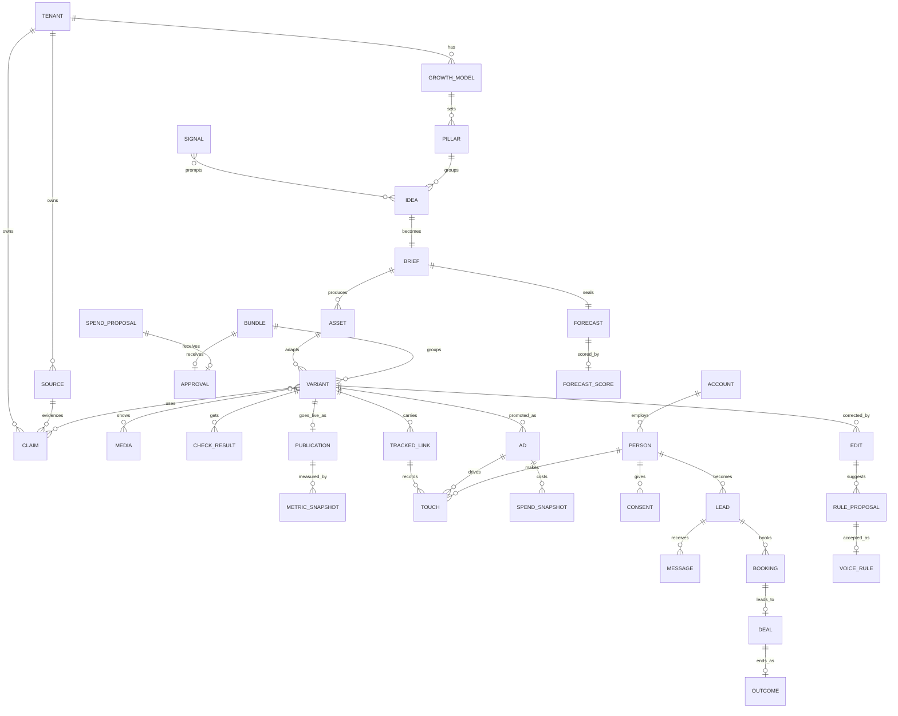

# WP-00: Contracts and scaffolding

Source of truth: `docs/BUILD_PLAN.md`. This file is a self-contained brief for one worker.

- **Wave:** Wave 0. Contracts
- **Owns (edit only these paths):** `contracts/`, `db/migrations/0001`, CI, `AGENTS.md`, `docs/`
- **Needs merged first:** None
- **Spec sections:** 2.1, 2.1b, 2.3, 2.8

## Done when

Every table in 2.3 exists as a migration and a typed model. The connection contract, state machine states and event names are defined. Fake clock and a mock provider for each capability exist. CI runs green with no keys.

## Report back

What is real, what is mocked, what needs Sai, and what you could not verify.

---

# Rules for every package

### 4.1 Rules for the build

- **Contracts first.** Package WP-00 freezes schemas, state names, the connection contract, event names and the fake clock. Nothing fans out before it is merged. After that, a contract change goes through the lead only.
- **One writer per path.** Each package owns the paths listed for it. A worker never edits outside them.
- **Mocks everywhere.** Every connection has `mock()`. All tests run with no keys and no network. No real send, post or spend without Sai's explicit yes.
- **Port what exists.** Section 4.2 lists what to keep. Do not regenerate it.
- **Deterministic code for rules.** Hashing, scoring, sizing, routing, caps and unlock rules are plain code with tests. Models are called only where language or judgment is needed.
- **Manual mode ships first** for every capability, then the default provider, then the alternatives.
- **Every package ends with:** tests passing, a short note of what is real, what is mocked and what needs Sai.
- **Merge gate.** Tests pass, a separate review agent finds no blocking bug, and a security review passes on the gate, vault, publisher, messaging and API packages. After each wave the verifier runs the fake-clock week end to end.
- **Parallelism.** Packages inside a wave are independent and can run together, three workers at a time by default. Raise that only if reviews keep up.
- **Models.** Lead, contracts, gate, truth, trust: Opus 5.5. Most packages: Sonnet 5.5. Fixtures, seed data, docs: Haiku 5.5. A second model family reviews the gate, truth and publisher.
- **Orchestration tool.** The packages are tool-agnostic. In Claude Code: one lead session, one git worktree per package. In MonoCode: one card per package, pasting the package row and the sections it names. `HANDOFF.md` records that MonoCode failed on its last assignment card, so test it on WP-01 before trusting it with a wave.
- **Existing hard limits stay.** `AGENTS.md` applies to every agent: no publishing, spending, account creation or secrets in chat. No AI attribution in commits. No em dashes or emoji in copy.
- **Apply for platform access on day one** (WhatsApp Cloud, Google Ads, Business Profile, any direct social APIs). Approval takes time nobody controls, and manual mode covers the gap.

### 4.3 Repository layout

```
cortex-operator/
  cortex_operator/
    contracts/     shared types, states, events, fake clock
    store/         Postgres access, tenant scoping
    connections/   registry, contract, vault
    providers/     one folder per capability, one file per provider
    truth/  gate/  brand/  media/  copy/  checks/  publish/
    capture/  tracking/  leads/  nurture/  growth/
    signals/  planner/  measure/  learning/  trust/  reports/
    ads/  engage/  extensions/
    api/           FastAPI routes and the MCP server
    worker/        job queue and state machine runner
  db/migrations/
  web/             Next.js phone-first app
  brand_templates/ HTML and CSS templates, tokens
  evals/           regression cases and golden sets
  demo/            seeded fictional business
  tests/
  docs/            this plan, one file per work package
```

---

# Spec: section 2.1

## 2.1 The design in one page

```mermaid
flowchart LR
    D["Diagnose: growth model finds the bottleneck"] --> P["Plan: play, pillars, week plan, sealed forecast"]
    P --> S["Source: voice notes, photos, claims"]
    S --> M["Make: copy and media compiled from brand system"]
    M --> C["Check: code checks, graders, second reader"]
    C --> A["Approve: one yes per bundle, bound to hash"]
    A --> U["Publish: fail-closed, read back live"]
    U --> L["Capture: tracked links, WhatsApp codes, forms"]
    L --> Q["Lead desk: consent, fit, heat, drafted reply"]
    Q --> B["Booked, held, won or lost"]
    B --> R["Measure: outcomes joined to asset and spend"]
    R --> X["Learn: forecasts scored, rules proposed, budget proposed"]
    X --> D
```



**Default stack.** You said not to be bound by the suggested tools, so these are the defaults I would ship. Section 2.1b makes every outside tool in this table a replaceable connection.

| Layer | Choice | Reason | Rejected |
|---|---|---|---|
| Record of truth | One Postgres (Supabase), row-level security per tenant | Auth, storage and policies in one place. You already run Supabase for Casa. | SQLite, Notion databases, HubSpot as system of record |
| Orchestration | A fixed state machine in Python, jobs in a Postgres queue with `SKIP LOCKED`, one worker | Code decides next steps. Restart-safe. Testable with a fake clock, which the repo already does. | LangGraph, CrewAI, n8n in the core path |
| Models | Sonnet 5.5 drafts and briefs. Haiku 5.5 extracts, classifies and grades. Opus 5.5 writes the weekly plan and monthly memo. A Gemini Flash-Lite model is the second reader. | The checker comes from a different model family than the writer, so they share fewer blind spots. | One model for everything. Fine-tuning. |
| Design and media | Brand tokens plus HTML and CSS templates rendered by headless Chromium to PNG, PDF and video frames. `ffmpeg` for cuts and captions. Image model only for backgrounds and illustration slots. | Type, grid and colour are deterministic. Indic and Latin scripts render with real fonts. | Generated layouts as the default. Avatar or lip-sync of a real person without a consent record. |
| Review surface | A phone-first web app (Next.js PWA). Reviewer gets a link by email or WhatsApp. | The reviewer is a founder on a phone. Approval must bind to a hash. | Notion as approval surface, chat UI |
| Calendar view | Notion mirror, one way out plus comments in | Keeps the calendar you asked for without trusting it. | Notion as source of truth |
| Publishing | Postiz hosted for social. Direct adapters only where Postiz has no route. A manual "copy pack and confirm link" path for everything. | One integration covers most channels. The manual path means a refused API never blocks a client. | Self-hosted Postiz for now (needs own developer apps per platform) |
| Leads | Own lead tables and a lead desk screen. WhatsApp Cloud API and email as channels. Optional one-way sync to a client CRM. | Small firms have no CRM or do not use it. | HubSpot free as the required surface |
| Booking | Cal.com link, or a callback slot picker for walk-in businesses | Free tier exists `[V]`. | Building a scheduler |
| Analytics in | GA4, Search Console, Postiz analytics, Meta and Google Ads reporting, plus our own redirect and code logs | Our own logs make the asset-to-lead join independent of cookies. | Any single attribution number |

**The play library.** A play is a row set, not code: channels, formats, qualification questions, what counts as a booked conversation, default pillar mix, and the metrics that matter. Three ship.

| Play | Fits | Channels | Booked conversation | First bottleneck to test |
|---|---|---|---|---|
| A. Local, high-ticket, walk-in | Vijay TVS, any dealer or showroom | Google Business Profile, WhatsApp, Facebook and Instagram in the local language, local search ads, click-to-WhatsApp ads | Showroom visit, test drive or callback | Enquiry response time and follow-up completion, then finance readiness of leads |
| B. B2B technical, trial-led | e-FEM, small SaaS | Search and answer-engine pages, expert LinkedIn profile plus company page, email, search ads on category terms | Demo or trial kickoff call | Being found for evaluation queries, then trial follow-up |
| C. Appointment service | Studios, clinics, consultancies | Business Profile, Instagram, reviews, booking link | Appointment | Review volume and booking friction |

Play C is designed for, not piloted.

---

# Spec: section 2.1b

## 2.1b Connections: every outside capability is a swappable port

The rule: the core never calls a vendor. It calls a **capability**. Each client picks which **connection** serves that capability, and can change it at any time, per brand, per format, or for one single piece.

**Three modes, always in this order of availability.**

1. **Manual.** A person uploads the file, pastes the link, or types the number. Every capability has this mode, so the product works with zero connections and no refused API can block a client.
2. **Local.** Runs on your own machine or server: a template render, a local model, a self-hosted tool.
3. **Hosted.** A paid provider, with a model picker where the provider offers several.

**What never changes when a connection changes.** The gate, content hashing, claim checks, provenance, disclosure labels, cost ledger and regional policy all sit above the port. Swapping Postiz for a direct API, or one video model for another, cannot route around an approval.

| Capability | Manual | Local | Hosted, examples | Default |
|---|---|---|---|---|
| Text: plan, draft, grade, second read | Paste your own copy | Any local model behind an OpenAI-compatible endpoint (Ollama and similar) | Claude, Gemini, OpenAI, any OpenAI-compatible provider. Model chosen per role. | Claude tiers, Gemini as second reader |
| Image | Upload a photo or finished graphic | Template render. A local diffusion endpoint. | Gemini image models, models listed on Muapi, others | Real photos, template render, hosted model for backgrounds |
| Video | Upload a finished clip | Template render to video (HyperFrames or Remotion `[?: licence]`), `ffmpeg` cuts and captions, raea on a local GPU | Any generative video model reachable through a provider such as Muapi or Gemini `[?: prices]` | Local cuts of real clips |
| Transcription | Type the answer | Local Whisper-class model | Hosted transcription | Local |
| Voiceover | Record your own | Local speech model | Hosted speech model | Record your own |
| Publishing | Copy pack, then confirm the live link | Self-hosted Postiz | Postiz hosted, direct platform APIs, another scheduler | Postiz hosted |
| Calendar view | Built-in week plan | None | Notion, Google Calendar | Built-in, mirrored to Notion |
| Leads and CRM | Built-in lead desk, CSV in and out | None | HubSpot, Zoho, a Google Sheet | Built-in |
| Messaging | Click-to-chat links, the seller's own mailbox | Your own SMTP server | WhatsApp Cloud API, Brevo, Resend, SES | Manual for first replies, always |
| Booking | Callback slot list | None | Cal.com, Calendly | Cal.com |
| Analytics in | CSV upload or typed numbers | Our own redirect and code logs | GA4, Search Console, scheduler analytics, Plausible | Own logs plus GA4 and Search Console |
| Ads | Person makes the change, spend imported by CSV | None | Meta, Google Ads, LinkedIn Ads | Manual |
| Research | Paste notes | None | A web search provider | Off |
| Storage | None | Local disk | Supabase storage, any S3-compatible store | Supabase |
| Notifications | None | None | Email, WhatsApp, Telegram, web push | Email and push |
| Automation hooks | None | None | Outbound webhooks to n8n, Zapier or Make. Events out only. They cannot publish. | Off |

**The connection contract.** Every provider, including manual ones, implements the same five calls:

- `describe()`: what it can do, limits, models offered, unit cost, licence note.
- `health()`: connected, token expiry, quota left.
- `estimate(request)`: cost and time before anything runs.
- `run(request)`: returns the result with provenance (who or what made it, which model, which settings), cost and external ids.
- `mock()`: a deterministic fake for tests and the demo client.

**Selection.** Each client has a default connection per capability and an ordered fallback list. A brief, a template or a single review card can override it: "use my upload", "render locally", "regenerate with model X". The choice and its cost are stored on the media or variant row.

**Rules for generated media, whatever the connection.**

- Provenance is recorded per file: client photo, client clip, template render, or generated with model and prompt.
- Generated people, products and premises are off by default. A client can switch them on per format.
- A real, identifiable person is never generated, voiced or lip-synced without a consent record on file.
- Generated or materially altered media carries the disclosure label the regional policy row requires.
- A generated image never carries a factual claim about the product. Claims ride on real photos or typeset text.

**Adding a provider** is one file that implements the contract plus a row in the registry. No core code changes.

---

# Spec: section 2.3

## 2.3 Data model

Every row carries `tenant_id`. Rows that came from a model also carry `prompt_version` and `model_id`, so a quality change can be traced to its cause.



**The chain, in words.**

- `signal` and `source` prompt an `idea`. An accepted idea becomes a `brief` with one sealed `forecast`.
- A brief produces one `asset` (the master) and one `variant` per channel. Each variant lists the `claim` rows and `media` it uses.
- Variants of one asset form a `bundle`. The bundle root hash covers every variant's text, every media file's bytes, every claim's evidence hash, the rule version and the channel.
- An `approval` points at that root. A `publication` can only be created from a variant whose bundle has a live approval.
- Each publication carries a `tracked_link`, a WhatsApp reference code, or both. A click or a coded chat creates a `touch` on a `person`.
- A person with a touch and a consent basis becomes a `lead`. Leads get `message` rows, a `booking`, then a `deal` and an `outcome` with amount or loss reason.
- `metric_snapshot` at day 2, 7 and 14 scores the `forecast`. Outcomes join back through touch to variant, pillar, format and channel, and through `ad` to spend.
- Every reviewer `edit` is stored as a diff with a reason. Repeated edits create a `rule_proposal`.

**Fields worth fixing on day one.**

- `claim`: `kind` (number, price, date, name, quote, capability), `value`, `unit`, `as_of`, `source_id`, `source_span`, `verified_by`, `verified_at`, `expires_at`, `languages` (approved wording per language).
- `media`: `sha256`, `provenance` (client photo, client clip, template render, generated background), `consent_id` when a person is identifiable, `alt_text`.
- `approval`: `bundle_root`, `approver_id`, `method` (per_bundle, express_list, template_instance), `seconds_on_screen`, `expires_at`, `canary` flag.
- `touch`: `kind` (link, whatsapp_code, form, call, walk_in_code, self_report), `variant_id`, `ad_id`, `occurred_at`. No IP address stored.
- `lead`: `fit` 0 to 100 from a readable rule table, `heat` as a decayed sum with a 14-day half-life (decay constant 0.0495 per day, which the brief verified), never blended into one number.
- `spend_proposal`: `campaign`, `from_daily`, `to_daily`, `reason`, `evidence_window`, `rule_fired`, then an approval.
- `autonomy_state`: `task_type`, `level`, `window_items`, `defects`, `escaped`, `canaries_shown`, `canaries_caught`.

---

# Spec: section 2.8

## 2.8 Where a human always stays, and the trust ladder

### Permanent human decisions

| Stays human | Why |
|---|---|
| The yes on any new copy or creative | The hard rule. Also the only real check on taste. |
| Verifying a claim | Every downstream check trusts this table. If a model can write to it, nothing is proven. |
| First reply to a named person, and all negotiation | Cannot be recalled. A wrong promise on price, finance or delivery is a liability. |
| Replies to comments, complaints and reviews | Platform rules and plain decency. Suggestions are fine. |
| Any spend increase, new campaign or new audience | Money moved in error does not come back. |
| Statements about named customers, competitors, pricing, legal or safety matters | Highest liability per sentence. The facts live in contracts and heads. |
| Raising a trust level or signing a template | Accountability needs a name. |
| Strategy: who to serve, what to stand for, what to refuse | The system has no stake and no customers. |
| Consent calls and anything the region policy marks as legal | Out of scope for software. |

### The ladder

Autonomy is tracked per client and per task type, for example "LinkedIn text post" or "offer carousel". A defect is a rejection or an edit that changes meaning, a claim or anything a hard rule covers. Typo fixes are logged and do not count.

| Level | What the system does alone | What the person sees | To unlock | 95% upper bound on true defect rate |
|---|---|---|---|---|
| L0 Shadow | Drafts only | The draft beside their own version | Starting state for a new task type | n/a |
| L1 Full review | Drafts, checks, renders | Every item as a full card with every check open | Calibration batch of 20 done, voice rules v1 signed | n/a |
| L2 Bundle review | Groups variants, sorts, collapses clean checks | One card per bundle, flags open | 50 items, at most 2 defects, none escaped, no hard-rule hit | 12.1% |
| L3 Express list | Presents clean bundles as one list with "approve all except". Auto-accepts plan slots for proven pillars. Picks posting times. | Thumbnails and first lines. Any item opens in full. | 100 items, at most 1 defect, none escaped, canary catch rate of at least 80% | 4.7% |
| L4 Template instances | Sends or posts instances of a hash-approved template whose slots fill only from verified data | A 1-in-20 sample after the fact, plus every flagged instance | Template signed, 200 instances, at most 3 defects, none escaped | 3.8% |

Bounds are exact one-sided binomial figures, taken from the brief and rechecked `[E]`.

**What this ladder refuses to do.** New copy never ships on a standing rule. At L3 the person still approves exact hashes, in one tap, after seeing them. L4 covers only text a person already approved word for word: an acknowledgement, a nurture email, a reminder. That is how "approval tied to the exact content" and "under 30 minutes" both hold.

**Reviewer canaries.** From L2 on, about 1 item in 20 is a planted flaw: a claim swapped for a wrong one, an off-brand image, a banned phrase. It is marked internally and the publisher refuses it whatever happens. If the reviewer approves it, they are told at once and that task type drops a level. The catch rate is the first honest measure of the human gate. Five canaries is thin evidence, and the screen says so.

**Demotion, applied the same day.**

- A hard-rule hit that reached approval, or any escaped defect: back to L1, incident note opened.
- Two defects in the last 20 items: down one level.
- A canary approved: down one level.
- Model or prompt version changes: down one level, re-earned with 30 clean items.
- A region policy row changes: affected task types to L1.
- A cost breaker trips twice in a week: that task type pauses.
