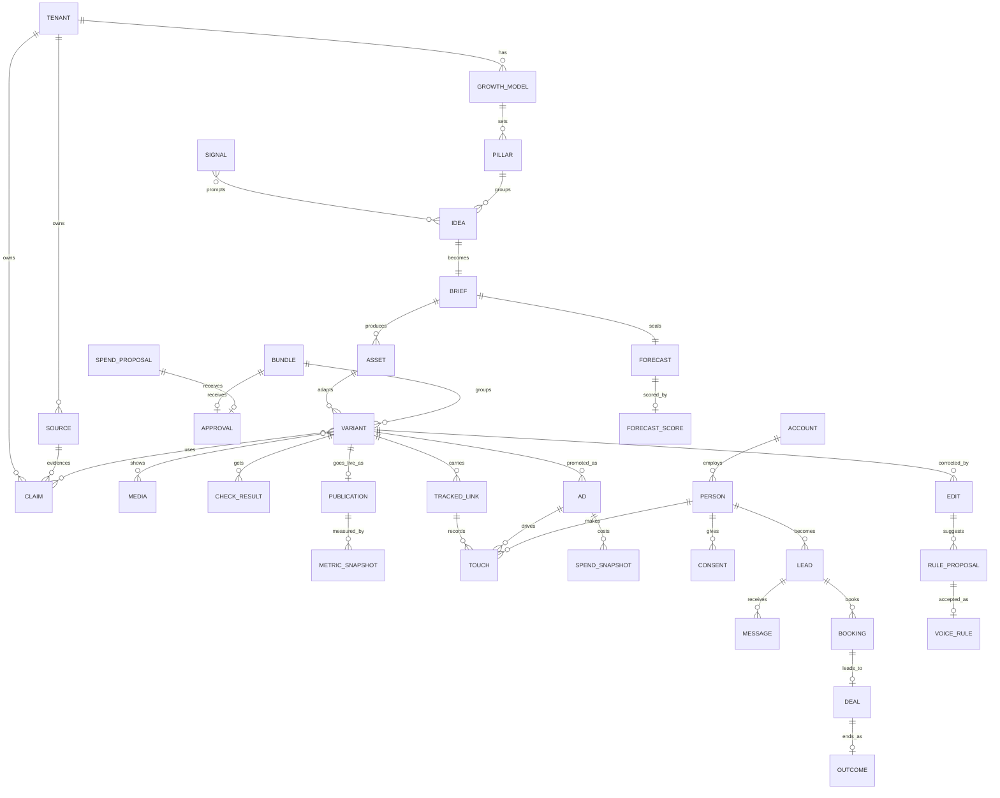

# WP-01: Data layer

Source of truth: `docs/BUILD_PLAN.md`. This file is a self-contained brief for one worker.

- **Wave:** Wave 1. Foundation
- **Owns (edit only these paths):** `store/`, `db/`
- **Needs merged first:** 00
- **Spec sections:** 2.1, 2.3

## Done when

Postgres replaces SQLite. Row-level security per tenant. A query as client A returns nothing of client B. Existing engine tests pass on the new store.

## Report back

What is real, what is mocked, what needs Sai, and what you could not verify.

---

# Rules for every package

### 4.1 Rules for the build

- **Contracts first.** Package WP-00 freezes schemas, state names, the connection contract, event names and the fake clock. Nothing fans out before it is merged. After that, a contract change goes through the lead only.
- **One writer per path.** Each package owns the paths listed for it. A worker never edits outside them.
- **Mocks everywhere.** Every connection has `mock()`. All tests run with no keys and no network. No real send, post or spend without Sai's explicit yes.
- **Port what exists.** Section 4.2 lists what to keep. Do not regenerate it.
- **Deterministic code for rules.** Hashing, scoring, sizing, routing, caps and unlock rules are plain code with tests. Models are called only where language or judgment is needed.
- **Manual mode ships first** for every capability, then the default provider, then the alternatives.
- **Every package ends with:** tests passing, a short note of what is real, what is mocked and what needs Sai.
- **Merge gate.** Tests pass, a separate review agent finds no blocking bug, and a security review passes on the gate, vault, publisher, messaging and API packages. After each wave the verifier runs the fake-clock week end to end.
- **Parallelism.** Packages inside a wave are independent and can run together, three workers at a time by default. Raise that only if reviews keep up.
- **Models.** Lead, contracts, gate, truth, trust: Opus 5.5. Most packages: Sonnet 5.5. Fixtures, seed data, docs: Haiku 5.5. A second model family reviews the gate, truth and publisher.
- **Orchestration tool.** The packages are tool-agnostic. In Claude Code: one lead session, one git worktree per package. In MonoCode: one card per package, pasting the package row and the sections it names. `HANDOFF.md` records that MonoCode failed on its last assignment card, so test it on WP-01 before trusting it with a wave.
- **Existing hard limits stay.** `AGENTS.md` applies to every agent: no publishing, spending, account creation or secrets in chat. No AI attribution in commits. No em dashes or emoji in copy.
- **Apply for platform access on day one** (WhatsApp Cloud, Google Ads, Business Profile, any direct social APIs). Approval takes time nobody controls, and manual mode covers the gap.

### 4.3 Repository layout

```
cortex-operator/
  thallo/
    contracts/     shared types, states, events, fake clock
    store/         Postgres access, tenant scoping
    connections/   registry, contract, vault
    providers/     one folder per capability, one file per provider
    truth/  gate/  brand/  media/  copy/  checks/  publish/
    capture/  tracking/  leads/  nurture/  growth/
    signals/  planner/  measure/  learning/  trust/  reports/
    ads/  engage/  extensions/
    api/           FastAPI routes and the MCP server
    worker/        job queue and state machine runner
  db/migrations/
  web/             Next.js phone-first app
  brand_templates/ HTML and CSS templates, tokens
  evals/           regression cases and golden sets
  demo/            seeded fictional business
  tests/
  docs/            this plan, one file per work package
```

---

# Spec: section 2.1

## 2.1 The design in one page

```mermaid
flowchart LR
    D["Diagnose: growth model finds the bottleneck"] --> P["Plan: play, pillars, week plan, sealed forecast"]
    P --> S["Source: voice notes, photos, claims"]
    S --> M["Make: copy and media compiled from brand system"]
    M --> C["Check: code checks, graders, second reader"]
    C --> A["Approve: one yes per bundle, bound to hash"]
    A --> U["Publish: fail-closed, read back live"]
    U --> L["Capture: tracked links, WhatsApp codes, forms"]
    L --> Q["Lead desk: consent, fit, heat, drafted reply"]
    Q --> B["Booked, held, won or lost"]
    B --> R["Measure: outcomes joined to asset and spend"]
    R --> X["Learn: forecasts scored, rules proposed, budget proposed"]
    X --> D
```



**Default stack.** You said not to be bound by the suggested tools, so these are the defaults I would ship. Section 2.1b makes every outside tool in this table a replaceable connection.

| Layer | Choice | Reason | Rejected |
|---|---|---|---|
| Record of truth | One Postgres (Supabase), row-level security per tenant | Auth, storage and policies in one place. You already run Supabase for Casa. | SQLite, Notion databases, HubSpot as system of record |
| Orchestration | A fixed state machine in Python, jobs in a Postgres queue with `SKIP LOCKED`, one worker | Code decides next steps. Restart-safe. Testable with a fake clock, which the repo already does. | LangGraph, CrewAI, n8n in the core path |
| Models | Sonnet 5.5 drafts and briefs. Haiku 5.5 extracts, classifies and grades. Opus 5.5 writes the weekly plan and monthly memo. A Gemini Flash-Lite model is the second reader. | The checker comes from a different model family than the writer, so they share fewer blind spots. | One model for everything. Fine-tuning. |
| Design and media | Brand tokens plus HTML and CSS templates rendered by headless Chromium to PNG, PDF and video frames. `ffmpeg` for cuts and captions. Image model only for backgrounds and illustration slots. | Type, grid and colour are deterministic. Indic and Latin scripts render with real fonts. | Generated layouts as the default. Avatar or lip-sync of a real person without a consent record. |
| Review surface | A phone-first web app (Next.js PWA). Reviewer gets a link by email or WhatsApp. | The reviewer is a founder on a phone. Approval must bind to a hash. | Notion as approval surface, chat UI |
| Calendar view | Notion mirror, one way out plus comments in | Keeps the calendar you asked for without trusting it. | Notion as source of truth |
| Publishing | Postiz hosted for social. Direct adapters only where Postiz has no route. A manual "copy pack and confirm link" path for everything. | One integration covers most channels. The manual path means a refused API never blocks a client. | Self-hosted Postiz for now (needs own developer apps per platform) |
| Leads | Own lead tables and a lead desk screen. WhatsApp Cloud API and email as channels. Optional one-way sync to a client CRM. | Small firms have no CRM or do not use it. | HubSpot free as the required surface |
| Booking | Cal.com link, or a callback slot picker for walk-in businesses | Free tier exists `[V]`. | Building a scheduler |
| Analytics in | GA4, Search Console, Postiz analytics, Meta and Google Ads reporting, plus our own redirect and code logs | Our own logs make the asset-to-lead join independent of cookies. | Any single attribution number |

**The play library.** A play is a row set, not code: channels, formats, qualification questions, what counts as a booked conversation, default pillar mix, and the metrics that matter. Three ship.

| Play | Fits | Channels | Booked conversation | First bottleneck to test |
|---|---|---|---|---|
| A. Local, high-ticket, walk-in | Vijay TVS, any dealer or showroom | Google Business Profile, WhatsApp, Facebook and Instagram in the local language, local search ads, click-to-WhatsApp ads | Showroom visit, test drive or callback | Enquiry response time and follow-up completion, then finance readiness of leads |
| B. B2B technical, trial-led | e-FEM, small SaaS | Search and answer-engine pages, expert LinkedIn profile plus company page, email, search ads on category terms | Demo or trial kickoff call | Being found for evaluation queries, then trial follow-up |
| C. Appointment service | Studios, clinics, consultancies | Business Profile, Instagram, reviews, booking link | Appointment | Review volume and booking friction |

Play C is designed for, not piloted.

---

# Spec: section 2.3

## 2.3 Data model

Every row carries `tenant_id`. Rows that came from a model also carry `prompt_version` and `model_id`, so a quality change can be traced to its cause.



**The chain, in words.**

- `signal` and `source` prompt an `idea`. An accepted idea becomes a `brief` with one sealed `forecast`.
- A brief produces one `asset` (the master) and one `variant` per channel. Each variant lists the `claim` rows and `media` it uses.
- Variants of one asset form a `bundle`. The bundle root hash covers every variant's text, every media file's bytes, every claim's evidence hash, the rule version and the channel.
- An `approval` points at that root. A `publication` can only be created from a variant whose bundle has a live approval.
- Each publication carries a `tracked_link`, a WhatsApp reference code, or both. A click or a coded chat creates a `touch` on a `person`.
- A person with a touch and a consent basis becomes a `lead`. Leads get `message` rows, a `booking`, then a `deal` and an `outcome` with amount or loss reason.
- `metric_snapshot` at day 2, 7 and 14 scores the `forecast`. Outcomes join back through touch to variant, pillar, format and channel, and through `ad` to spend.
- Every reviewer `edit` is stored as a diff with a reason. Repeated edits create a `rule_proposal`.

**Fields worth fixing on day one.**

- `claim`: `kind` (number, price, date, name, quote, capability), `value`, `unit`, `as_of`, `source_id`, `source_span`, `verified_by`, `verified_at`, `expires_at`, `languages` (approved wording per language).
- `media`: `sha256`, `provenance` (client photo, client clip, template render, generated background), `consent_id` when a person is identifiable, `alt_text`.
- `approval`: `bundle_root`, `approver_id`, `method` (per_bundle, express_list, template_instance), `seconds_on_screen`, `expires_at`, `canary` flag.
- `touch`: `kind` (link, whatsapp_code, form, call, walk_in_code, self_report), `variant_id`, `ad_id`, `occurred_at`. No IP address stored.
- `lead`: `fit` 0 to 100 from a readable rule table, `heat` as a decayed sum with a 14-day half-life (decay constant 0.0495 per day, which the brief verified), never blended into one number.
- `spend_proposal`: `campaign`, `from_daily`, `to_daily`, `reason`, `evidence_window`, `rule_fired`, then an approval.
- `autonomy_state`: `task_type`, `level`, `window_items`, `defects`, `escaped`, `canaries_shown`, `canaries_caught`.
