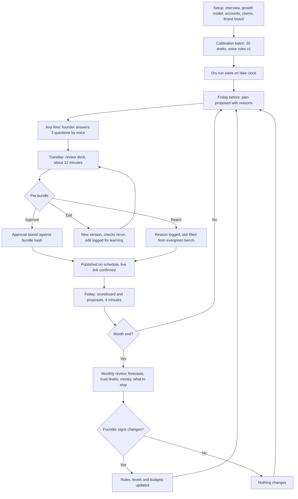

# WP-09: Web app shell, review deck, week plan, connections screen

Source of truth: `docs/BUILD_PLAN.md`. This file is a self-contained brief for one worker.

- **Wave:** Wave 2. Production
- **Owns (edit only these paths):** `web/`, `api/review.py`, `api/plan.py`, `api/connections.py`
- **Needs merged first:** 01, 02, 04
- **Spec sections:** 2.4, 2.5

## Done when

Phone-first app with login and client switch. Review deck approves, edits and rejects bundles against the gate. Seconds on screen recorded. Connections screen shows mode, provider, model, health and cost, with a test button.

## Report back

What is real, what is mocked, what needs Sai, and what you could not verify.

---

# Rules for every package

### 4.1 Rules for the build

- **Contracts first.** Package WP-00 freezes schemas, state names, the connection contract, event names and the fake clock. Nothing fans out before it is merged. After that, a contract change goes through the lead only.
- **One writer per path.** Each package owns the paths listed for it. A worker never edits outside them.
- **Mocks everywhere.** Every connection has `mock()`. All tests run with no keys and no network. No real send, post or spend without Sai's explicit yes.
- **Port what exists.** Section 4.2 lists what to keep. Do not regenerate it.
- **Deterministic code for rules.** Hashing, scoring, sizing, routing, caps and unlock rules are plain code with tests. Models are called only where language or judgment is needed.
- **Manual mode ships first** for every capability, then the default provider, then the alternatives.
- **Every package ends with:** tests passing, a short note of what is real, what is mocked and what needs Sai.
- **Merge gate.** Tests pass, a separate review agent finds no blocking bug, and a security review passes on the gate, vault, publisher, messaging and API packages. After each wave the verifier runs the fake-clock week end to end.
- **Parallelism.** Packages inside a wave are independent and can run together, three workers at a time by default. Raise that only if reviews keep up.
- **Models.** Lead, contracts, gate, truth, trust: Opus 5.5. Most packages: Sonnet 5.5. Fixtures, seed data, docs: Haiku 5.5. A second model family reviews the gate, truth and publisher.
- **Orchestration tool.** The packages are tool-agnostic. In Claude Code: one lead session, one git worktree per package. In MonoCode: one card per package, pasting the package row and the sections it names. `HANDOFF.md` records that MonoCode failed on its last assignment card, so test it on WP-01 before trusting it with a wave.
- **Existing hard limits stay.** `AGENTS.md` applies to every agent: no publishing, spending, account creation or secrets in chat. No AI attribution in commits. No em dashes or emoji in copy.
- **Apply for platform access on day one** (WhatsApp Cloud, Google Ads, Business Profile, any direct social APIs). Approval takes time nobody controls, and manual mode covers the gap.

### 4.3 Repository layout

```
cortex-operator/
  thallo/
    contracts/     shared types, states, events, fake clock
    store/         Postgres access, tenant scoping
    connections/   registry, contract, vault
    providers/     one folder per capability, one file per provider
    truth/  gate/  brand/  media/  copy/  checks/  publish/
    capture/  tracking/  leads/  nurture/  growth/
    signals/  planner/  measure/  learning/  trust/  reports/
    ads/  engage/  extensions/
    api/           FastAPI routes and the MCP server
    worker/        job queue and state machine runner
  db/migrations/
  web/             Next.js phone-first app
  brand_templates/ HTML and CSS templates, tokens
  evals/           regression cases and golden sets
  demo/            seeded fictional business
  tests/
  docs/            this plan, one file per work package
```

---

# Spec: section 2.4

## 2.4 Screens

| Screen | Who | What it shows |
|---|---|---|
| **Review deck** | Founder, phone | One card per bundle. Rendered pieces, swipe across channels. One line on why this piece and why now. Claims used, each tappable to its source. Check results, collapsed when clean. Forecast range. Actions: approve, edit in place (checks rerun in seconds), reject with one tap on a reason, later. Any image or clip on a card can be replaced by an upload, rendered locally, or regenerated with a chosen model. |
| **Voice inbox** | Founder, staff | This week's three questions with a record button. Shot-list requests ("a 20-second clip of today's delivery"). Upload with a consent tick when a customer is visible. |
| **Week plan** | Founder, operator | Seven days of slots by channel. Each slot shows pillar, funnel stage and status. A bar comparing the stage mix with the play's target. Drag to move, tap to kill. Mirrored to Notion. |
| **Lead desk** | Seller | Leads on a fit-by-heat grid. Per lead: where they came from, their answers, the suggested next step, a drafted reply that opens in WhatsApp or mail, a clock, and outcome buttons (booked, no answer, not a fit, held, won, lost with reason). |
| **Money** | Founder | Spend by campaign. Cost per qualified lead and per booked conversation with ranges. Pacing against caps. A queue of spend proposals, each with the rule that fired, to sign or decline. |
| **Scoreboard** | Founder, public version | The eight targets with trend and sample size. Forecast hits and misses, biggest miss first. What earned calendar share. Leads with no known source. |
| **Truth library** | Operator, founder | Claims with value, source, expiry and where used. Expiring soon. Candidates awaiting verification. |
| **Brand system** | Operator | Voice rules, each linked to the edit that created it. Slop catalogue. Template gallery with pass rates. Board of approved and rejected examples. |
| **Trust and audit** | Operator, founder | Level per task type with evidence counts and bounds. Canary results. Incidents. Kill switch per brand and global. Full export. |
| **Operator console** | Sai | All clients: queue health, cost against cap, breaker trips, prompt versions, eval results, token expiries. |
| **Connections** | Operator, founder | One row per capability: text, image, video, transcription, publishing, calendar, CRM, messaging, booking, analytics, ads, storage. For each: the chosen mode (manual, local, hosted), the provider and model, health, quota, cost this month, a test button, and the fallback order. Add or swap a provider without touching anything else. |
| **Demo** | Anyone with the link | The seeded fictional business, replayable on the fake clock, every screen labelled as a simulation. |

---

# Spec: section 2.5

## 2.5 Journey of the user

**Setup, once, over two weeks.** Founder minutes are the scarce resource, so the operator does the heavy work.

| Who | Step | Minutes |
|---|---|---|
| Founder | Kickoff interview, recorded: customers, offer, what must never be said | 45 |
| Founder | Growth model form: prices, margin, where enquiries come from, close rate guesses | 15 |
| Founder | Connect accounts with the operator on a call | 30 |
| Founder | Verify about 40 claim candidates the system extracted, 30 seconds each | 25 |
| Founder | Brand board: pick 10 liked and 10 disliked references | 15 |
| Founder | Calibration batch: react to 20 drafts | 40 |
| Founder | Sign the policy, approver list and spend caps | 10 |
| **Founder total** | | **180** `[E]` |
| Operator | Ingest site and documents, extract claim candidates | 60 |
| Operator | Design tokens and first 8 templates | 300 |
| Operator | Voice rules v1 from past posts and kickoff | 60 |
| Operator | Play selection, pillars, qualification questions, lead routing | 90 |
| Operator | Tracking: redirector, codes, forms, analytics connections | 120 |
| Operator | Region policy rows from the client's adviser | 30 |
| Operator | Dry-run week on a fake clock | 60 |
| **Operator total** | | **720** `[E]` |

**Weekly routine at steady state** `[T]`. Expect 60 to 90 minutes a week in month one `[E]`.

| When | Step | Minutes |
|---|---|---|
| Any time | Answer three questions by voice | 6 |
| Tuesday | Review deck: about 8 bundles at 75 seconds, plus two edits | 12 |
| Tuesday | Glance at next week's plan, kill or move | 2 |
| Friday | Scoreboard, sign or decline proposals | 4 |
| **Total** | | **24** |

**Monthly review**, 20 minutes, replacing nothing: forecast record (5), trust levels and rule proposals (5), money and budget proposal (5), next month's themes and what to stop (5). Averaged in, the founder spends about 29 minutes a week `[T]`.

**Not counted, and said plainly:** replying to leads, replying to comments, and a 90-minute strategy session each quarter.


