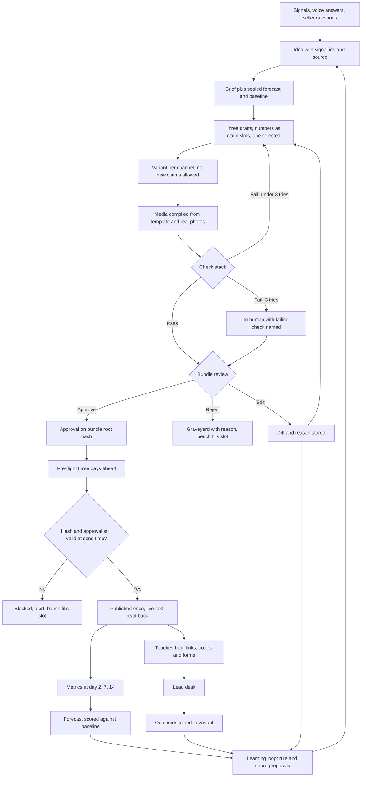
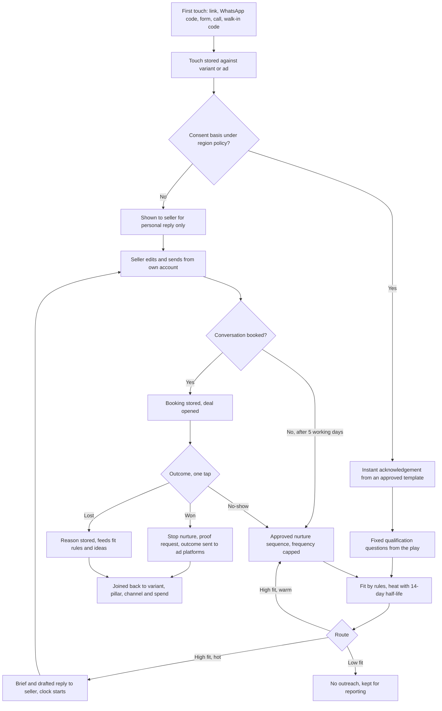

# WP-17: Planner, forecasts and calendar mirror

Source of truth: `docs/BUILD_PLAN.md`. This file is a self-contained brief for one worker.

- **Wave:** Wave 4. Intelligence
- **Owns (edit only these paths):** `planner/`, `providers/calendar/`
- **Needs merged first:** 10, 15, 16
- **Spec sections:** 2.6 post journey, module 7

## Done when

Weekly plan with reasons. No source, no slot. Stage mix checked against the play. Interval forecasts sealed with a naive baseline. Built-in week plan, Notion mirror and Google Calendar pass the contract tests.

## Report back

What is real, what is mocked, what needs Sai, and what you could not verify.

---

# Rules for every package

### 4.1 Rules for the build

- **Contracts first.** Package WP-00 freezes schemas, state names, the connection contract, event names and the fake clock. Nothing fans out before it is merged. After that, a contract change goes through the lead only.
- **One writer per path.** Each package owns the paths listed for it. A worker never edits outside them.
- **Mocks everywhere.** Every connection has `mock()`. All tests run with no keys and no network. No real send, post or spend without Sai's explicit yes.
- **Port what exists.** Section 4.2 lists what to keep. Do not regenerate it.
- **Deterministic code for rules.** Hashing, scoring, sizing, routing, caps and unlock rules are plain code with tests. Models are called only where language or judgment is needed.
- **Manual mode ships first** for every capability, then the default provider, then the alternatives.
- **Every package ends with:** tests passing, a short note of what is real, what is mocked and what needs Sai.
- **Merge gate.** Tests pass, a separate review agent finds no blocking bug, and a security review passes on the gate, vault, publisher, messaging and API packages. After each wave the verifier runs the fake-clock week end to end.
- **Parallelism.** Packages inside a wave are independent and can run together, three workers at a time by default. Raise that only if reviews keep up.
- **Models.** Lead, contracts, gate, truth, trust: Opus 5.5. Most packages: Sonnet 5.5. Fixtures, seed data, docs: Haiku 5.5. A second model family reviews the gate, truth and publisher.
- **Orchestration tool.** The packages are tool-agnostic. In Claude Code: one lead session, one git worktree per package. In MonoCode: one card per package, pasting the package row and the sections it names. `HANDOFF.md` records that MonoCode failed on its last assignment card, so test it on WP-01 before trusting it with a wave.
- **Existing hard limits stay.** `AGENTS.md` applies to every agent: no publishing, spending, account creation or secrets in chat. No AI attribution in commits. No em dashes or emoji in copy.
- **Apply for platform access on day one** (WhatsApp Cloud, Google Ads, Business Profile, any direct social APIs). Approval takes time nobody controls, and manual mode covers the gap.

### 4.3 Repository layout

```
cortex-operator/
  thallo/
    contracts/     shared types, states, events, fake clock
    store/         Postgres access, tenant scoping
    connections/   registry, contract, vault
    providers/     one folder per capability, one file per provider
    truth/  gate/  brand/  media/  copy/  checks/  publish/
    capture/  tracking/  leads/  nurture/  growth/
    signals/  planner/  measure/  learning/  trust/  reports/
    ads/  engage/  extensions/
    api/           FastAPI routes and the MCP server
    worker/        job queue and state machine runner
  db/migrations/
  web/             Next.js phone-first app
  brand_templates/ HTML and CSS templates, tokens
  evals/           regression cases and golden sets
  demo/            seeded fictional business
  tests/
  docs/            this plan, one file per work package
```

---

# Module rows

| # | Module | Job in plain language | Inputs | Outputs | Tools | Failure modes, and the guard | Cost | Effort | Moves |
|---|---|---|---|---|---|---|---|---|---|
| 7 | Planner | Proposes next week's pieces with a reason, a brief and a sealed prediction | Growth model, pillars, signals, source backlog, forecast scores, graveyard | `idea`, `brief`, `forecast`, week plan, Notion mirror | Opus weekly plan, Sonnet briefs, existing `foresight.py` | A calendar of guesses. Top-of-funnel only. Guard: no source, no slot. Stage mix checked against the play. Refuses to plan if claims or pillars are empty | EUR 2 to 4 | 5 | T1 T3 T7 |

---

# Spec: section 2.6

## 2.6 Journey of a post, a lead, and the money

### Journey of a post

1. **Signal.** Nightly pulls plus this week's voice answers and seller questions arrive. Web research is stored as untrusted text and can only suggest a claim candidate.
2. **Idea.** The planner proposes ideas, each with its signal ids, pillar, funnel stage and source. No source, no idea.
3. **Brief and forecast.** The brief names the audience, the job the buyer is trying to do, the single message, the channel, the allowed claims and the call to action. A forecast range for one metric at day 14 is sealed alongside a naive baseline.
4. **Draft.** Three candidates for the master. Numbers exist only as claim slots. The slop catalogue and the sameness check run. One candidate is selected, with the reason stored.
5. **Adapt.** One variant per channel. Variants may shorten, reorder and reformat. They may not add a claim.
6. **Media.** Text flows into a template chosen from the rotation. Real photos first, generated backgrounds second. The connection for each image or clip follows the client's defaults and can be overridden on the card.
7. **Check.** Code checks, then graders, then the second reader. Up to three repair loops, then to the human with the failing check named.
8. **Bundle and approve.** Master and variants appear as one card. One yes creates an approval on the bundle root.
9. **Pre-flight and schedule.** Size, length, link, account connection and time zone are checked three days ahead.
10. **Publish.** The publisher recomputes the hash, checks the approval is live, sends once, and reads the live post back to compare.
11. **Capture.** Clicks, coded chats and forms create touches tied to the variant.
12. **Measure.** Metrics at day 2, 7 and 14. Leads and outcomes join back as they happen.
13. **Learn.** The forecast is scored. The edit diff and any rejection reason go to the learning loop. The pillar, format and channel estimates update.



### Journey of a lead

1. **First touch.** A tracked click, a WhatsApp chat carrying a reference code, a form, a call, or a walk-in who mentions an offer code. A `touch` is stored against the variant or ad.
2. **Identity.** The person is matched or created. Company comes from the email domain or the lead's own answer. No scraped profiles.
3. **Consent.** The region policy row decides what may be sent, on which channel, with which footer. No basis means the lead is shown to the seller for a personal reply only.
4. **Instant acknowledgement.** A message the owner approved once, by hash, with slots filled only from the lead's own words. It promises nothing.
5. **Qualification.** Two or three fixed questions from the play. For a dealer: which model, cash or finance, town, timing. For a software reseller: use case, current tool, team size, timing. Answers are stored as typed fields.
6. **Scoring.** Fit from the rule table. Heat from decayed actions. Two numbers, shown on a grid.
7. **Routing.** High fit and hot: an account brief and a drafted reply reach the seller with a clock. High fit and warm: an approved nurture sequence. Low fit: no outreach, kept for reporting.
8. **Human reply.** The seller edits and sends from their own WhatsApp or mailbox. This never becomes automatic.
9. **Booking.** The reply carries the booking link or a callback slot. A booking creates the deal.
10. **Outcome.** One tap from the seller: held or no-show, then won with amount or lost with a reason from a fixed list.
11. **After.** Won: nurture stops, a customer-proof request is scheduled, outcome events go to the ad platforms. Lost: the reason feeds the fit rules and the idea queue.



### How it decides what performs better

**One outcome ladder.** Each piece and channel is judged on the highest rung that has enough data:

1. Won deals and their value.
2. Booked conversations.
3. Qualified leads.
4. High-intent actions: chat starts, calls, direction requests, pricing or trial page visits.
5. Engaged reach from the target audience: saves, shares, real comments.

Reach and likes alone never move a decision.

**Three source signals, side by side.** First touch, last touch, and the lead's own answer to "how did you hear about us". None is called the truth. The scoreboard shows all three and the share of leads with no source at all.

**Shrinkage, so small numbers stay humble.** Each attribute (pillar, format, hook type, channel) gets a rate estimate pulled toward the brand's overall average, with the pull weakening as evidence grows. In plain terms: three bookings from four posts does not beat ten from forty until there is more data. The engine reports the probability that one attribute beats another.

**A minimum evidence rule.** No proposal unless that probability is at least 80% and each side has at least 8 pieces. Otherwise the output is "no decision this month", in those words.

**Capped moves.** A pillar's share of the calendar moves by at most 10 points a month. No pillar drops below 10%. Twenty percent of slots stay reserved for new ideas.

**Forecasts as the referee.** A prompt version, a hook type or a planner change gets credit only if its sealed forecasts beat the naive baseline. Otherwise it is noise that happened to look good.

**How it changes the plan.** The Friday proposal lists the share change, the evidence, and the pieces that would be dropped. The founder signs it or does not.

### How it moves the ad budget

**The target is derived, never guessed.**

- Allowable cost per booked conversation: `A = margin per won deal x show rate x close rate x share of margin the owner will spend`. The share defaults to 30% and the owner sets it.
- Break-even return on ad spend is `1 / margin rate`. The target return is `1 / (margin rate x share)`.
- Worked example with invented numbers, for illustration only: margin EUR 600 per deal, 70% of bookings held, 25% of held conversations won, 30% share. `A = 600 x 0.70 x 0.25 x 0.30 = EUR 31.50` per booked conversation.

**A stated target per channel**, as a multiple of `A`. These multiples are my starting defaults, not benchmarks `[E]`. They are retuned after 90 days of the client's own data.

| Channel role | Target cost per booked conversation | Reason |
|---|---|---|
| Search on brand and high-intent terms | At most 0.6 A | Demand already exists. It should be the cheapest. |
| Local social, click-to-WhatsApp or lead forms | At most 1.0 A | Creates demand. Judged on qualified rate, never on raw lead cost. |
| Boosting an organic piece | At most 1.0 A | Only pieces that beat their sealed forecast get paid reach. |
| Retargeting | At most 0.8 A, capped at 20% of budget | Many of these people would have come anyway. |
| LinkedIn to a named account list (B2B) | At most 1.5 A for 90 days, then 1.0 A | Expensive clicks. Justified only where deal value is high and repeat revenue exists. |

**The method to reach it, in order.**

1. **Feed real outcomes back.** Qualified, booked and won events are uploaded to Google and Meta so their bidding chases buyers instead of form fills. For lead generation this is the largest single lever I know of.
2. **Promote proven pieces.** Paid creative comes from organic pieces that beat forecast, so the test was free.
3. **Keep the message continuous.** The ad, the landing page or WhatsApp opener, and the first reply all carry the same claim.
4. **Prune weekly.** Search terms that never qualify become negative keywords, proposed for sign-off.
5. **A written stopping rule.** If a campaign has spent 3 x A with zero booked conversations, a pause is proposed. Reasoning: if the true cost were A, the chance of zero bookings after spending 3 A is about 5% `[E: Poisson, e to the minus 3]`.
6. **Capped shifts.** Budget moves toward the lowest cost per qualified booking, at most 20% of a campaign's budget per week, so platform learning is not reset `[?: exact platform thresholds not verified]`.
7. **Holdouts when spend allows.** Above roughly EUR 1,500 a month on one platform `[E]`, a region or a week is held out to measure true lift.

**Who moves the money.** Every increase, new campaign and new creative is a `spend_proposal` a named person signs. In the first months the person also makes the change in the ad platform and the system verifies it. Later the system applies signed changes itself. The only thing it may do unasked is pause: on a tripped cap, a broken landing page, or pacing above 150% of the daily cap. Pausing spends less, so it sits inside the hard rule.
